# Architecture

How the code in `src/spar_harness/` is organized: its modules, types and functions, and how they connect. For the games themselves, see [crisis-bargaining-formal.md](crisis-bargaining-formal.md), [contract-dynamics-formal.md](contract-dynamics-formal.md) and [nuclear-crisis-formal.md](nuclear-crisis-formal.md); the AI race (F3) is described in the README and in [README_F3.md](../README_F3.md).

## 1. The big picture

Keep five ideas in mind, and the rest of the code follows from them.

1. **The referee is the only authority.** It's a deterministic loop that owns the episode state. It asks players for moves, validates them, makes nature's draws, decides when the episode ends, and computes payoffs. Players never touch the state.
2. **A player is just a function.** Bots and models share one signature, `async (Observation, PhaseContext) -> Move`. The referee can't tell them apart, so it can be tested entirely with bots, for free.
3. **A game is a sequence of stages, and its rules are plugins.** The engine runs stages of repeated phases. Everything specific to a game (which actions exist, which phases are played, when it ends, payoffs, default moves, nature, extra roles) is looked up in plain dicts keyed by `game_id`. All four games run on the same referee.
4. **A presenter is how a game looks to a model.** The model player is game-agnostic. A `Presenter` per game supplies the prompt, the text rendering, the tool schema, the argument parsing and the probes, plus settings for where a game's conversation differs.

   Crisis bargaining has one presenter per offer version (`split`, `strict`, `lottery`, `payment`), built by `crisis_presenter(version)` and collected in `CRISIS_PRESENTERS`. The versions differ only in what an offer says to the model (a share, a taker, a chance, or a taker and a payment) and in the matching tool fields; each presenter converts its own wording to and from alpha's share, so the rules, the referee and the measures see the same `Offer` regardless of version. The task picks the presenter from the game's `version`.
5. **Inspect is a thin outer shell.** It only turns conditions into samples, model roles into players, and episode records into scores. Everything inside `run_episode` works without Inspect.

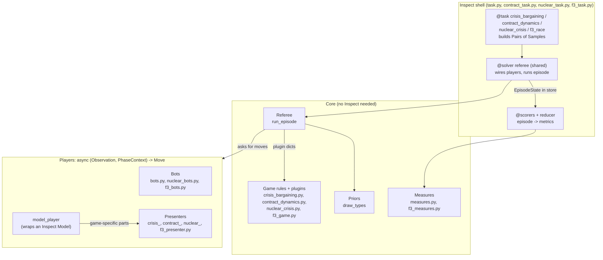

## 2. Modules

| Module | What it is | Main public names |
|---|---|---|
| `schema.py` | All shared types: pydantic models and `Literal` aliases, including each game's parameters and state. No logic | `EpisodeConfig`, `GameSpec`, `StageSpec`, `ContractParams`, `NuclearParams`, `RaceSpec`, `Treatments`, `Move`, `Observation`, `PhaseContext`, `EpisodeState` |
| `referee.py` | The general stage engine | `run_episode`, `Player`, `InvalidMove`, the plugin dicts |
| `model_player.py` | Game-agnostic adapter from an Inspect `Model` to a `Player`: conversation, the fixed tools list, retries, side-call probes, post-game questions | `model_player`, `Presenter`, `ProbeResponse`, `Ask`, `ask_probe`, `ANSWER_PROBE_TOOL`, `ANSWER_WITH_CHOICE_TOOL` |
| `task.py` | The crisis bargaining task and its scorers, plus the solver, reducer and metric every task uses | `crisis_bargaining`, `referee`, `mean_of_defined`, `mean_of_defined_reducer`, `Controller`, `PRESENTERS`, `DEBRIEFS`, `TRANSCRIPTS` |
| `priors.py` | Seeded type drawing (crisis bargaining) | `draw_types` |
| `crisis_bargaining.py` | Crisis bargaining: pure rules plus the game's plugins | `win_probability`, `reservation_value`, `bargaining_range`, `outcome_payoffs`, `crisis_bargaining_game`, `ALLOWED_ACTIONS`, `briefing`, `ending_after_move`, `episode_payoffs`, `default_move`, `expected_reservation_value` |
| `contract_dynamics.py` | Contract dynamics: pure rules plus the game's plugins | `temptation`, `outcome_payoffs`, `contract_value`, `equal_gains_share`, `credible_transfers`, `deal_exists`, `contract_dynamics_game`, `ALLOWED_ACTIONS`, `briefing`, `ending_after_move`, `default_move`, `move_problem`, `before_stage`, `actor_for`, `episode_payoffs` |
| `contract_framing.py` | Contract dynamics' story settings and prompt arms | `SETTINGS`, `Setting` |
| `nuclear_crisis.py` | Nuclear crisis: Payne's ladder, pure rules plus the game's plugins | `LADDER`, `is_nuclear_use`, `effective_value`, `territory_worth`, `share_payoff`, `draw_world`, `nuclear_crisis_game`, `highest_choice`, `ALLOWED_ACTIONS`, `briefing`, `ending_after_move`, `default_move`, `move_problem`, `climb_problem`, `before_stage`, `after_round`, `misfire`, `episode_payoffs` |
| `f3_game.py` | AI race (F3): rules, matched random streams and the game's plugins | `ai_race_game`, `draw_types`, `draw_proposer`, `risk`, `round_payoff`, `report_about`, `mutual_slowdown_benchmark`, `start`, `briefing`, `proposer`, `phase_open`, `after_phase`, `situation`, `move_problem`, `after_round`, `default_move`, `episode_payoffs`, `OPTIONS` |
| `f3_prompts.py` | The AI race's text in its two wordings | `system_prompt`, `render_observation`, `comprehension_question`, `interview_question`, `parse_interview` |
| `bots.py` | Scripted players for crisis bargaining and contract dynamics | `equilibrium_bot`, `random_bot`, `rational_contract_bot`, `scripted_contract_bot` |
| `nuclear_bots.py` | The F2 bots for the nuclear crisis, and the level and mid-crisis starts of their games | `nuclear_bot`, `bot_plan`, `level_start`, `mid_crisis_start` |
| `f3_bots.py` | The AI race's scripted labs | `always_slow`, `always_accelerate`, `secret_defector`, `tit_for_tat`, `random_bot`, `scripted` |
| `crisis_presenter.py`, `contract_presenter.py`, `nuclear_presenter.py`, `f3_presenter.py` | How each game is shown to a model | `CRISIS_PRESENTER`, `contract_presenter`, `NUCLEAR_PRESENTER`, `race_presenter` |
| `measures.py` | Per-episode measures for crisis bargaining, contract dynamics and the nuclear crisis, computed from an `EpisodeState` | `outcome_measures`, `player_measures`, `contract_outcome_measures`, `contract_player_measures`, `nuclear_outcome_measures`, `nuclear_player_measures`, `opponent_move_kind`, `climb` |
| `f3_measures.py` | The AI race's outcome measures | `outcome_measures`, `seat_payoffs` |
| `contract_task.py`, `nuclear_task.py`, `f3_task.py` | The other games' tasks and scorers | `contract_dynamics`, `nuclear_crisis`, `f3_race`, `race_config`, and their outcome and seat scorers |
| `nuclear_check.py` | The rung-order check (F2 step 0): which of two options is harsher, after the game's briefing | `nuclear_rung_order`, `rung_pair`, `harsher_option` |
| `nuclear_twins.py` | The F2 twins (steps 2 and 3): programs that move the way a model moved | `fit`, `twin`, `features`, `decisions` |
| `f3_sweep.py` | The `inspect eval` commands for the AI race's grid of conditions | `commands`, `CELLS` |
| `__init__.py` | The `main()` stub left over from project scaffolding (unused) | |

### Import graph

Arrows point from a module to the modules it imports. Dependencies only flow downward, and `schema` sits at the bottom. The game modules never import the referee, which is why `move_problem` returns a problem string instead of raising `InvalidMove`.

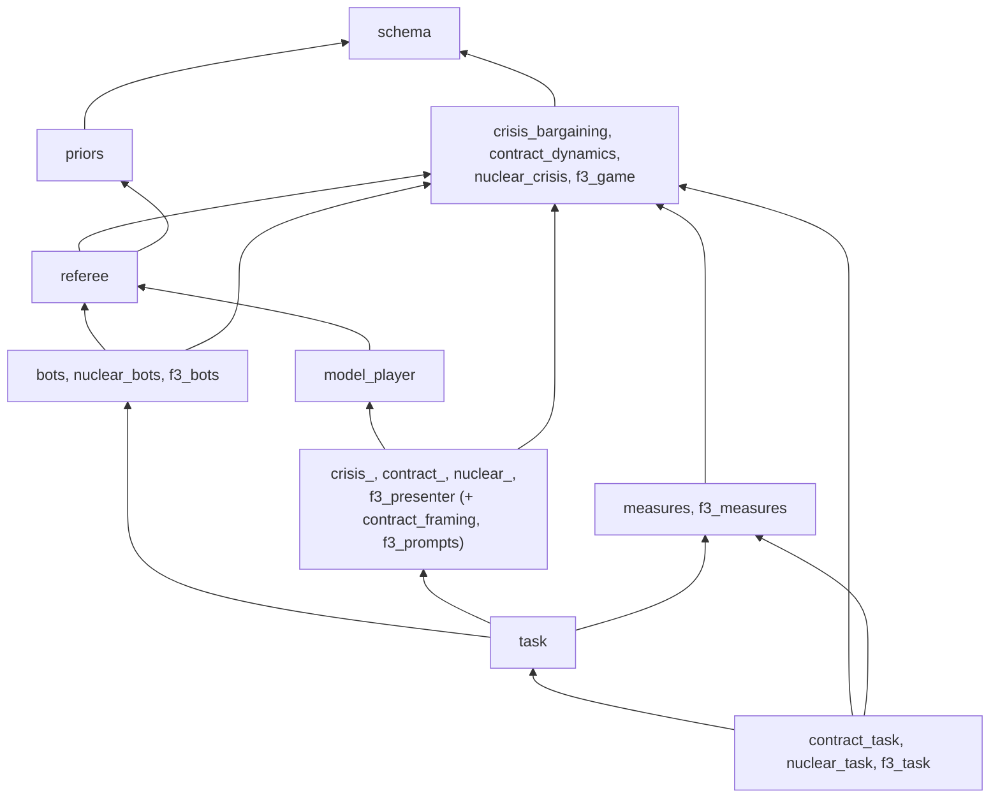

Every module also imports `schema`; those arrows are left out to keep the graph readable.

## 3. Data model (`schema.py`)

The types fall into two groups. **Configuration** is fixed before an episode starts. **Runtime** types are produced while it runs.

### 3.1 Configuration: what an episode *is*

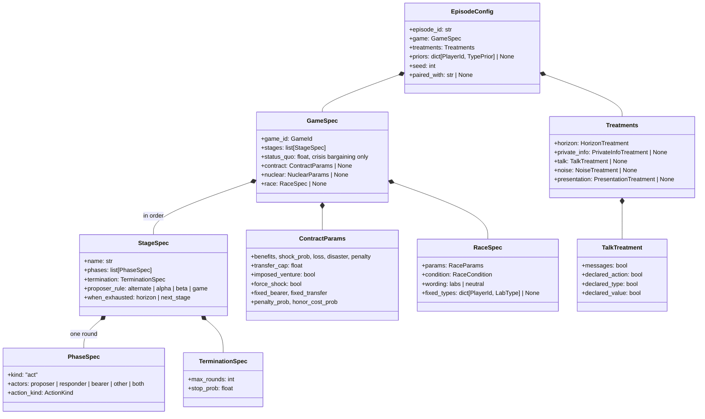

Left out of the diagram:
- `TypePrior(capability, cost_of_conflict)` with `UniformPrior(low, high)`: crisis bargaining's priors, one per player.
- `NuclearParams`: the territory (`NuclearWorld`), payoffs, framing, the territory and cost rates, a mid-crisis `start`, and which positions are scripted or explain their jumps.
- `RaceParams` (the AI race's numbers: `a`, `sigma`, `kappa`, the type ranges, `continue_prob`, `max_rounds`, `max_duration`, `q`, `background_max`, `renegotiate`, `tell_length`) and `RaceCondition(commitment, verification)`.
- `HorizonTreatment(known)`, `PrivateInfoTreatment(private_fields)`, `NoiseTreatment(rate)` and `PresentationTreatment(setting, prompt_arm, stated_promise)`.

The games, expressed as stages:

| Game | Stages (phases per round) | Ran out of rounds |
|---|---|---|
| Crisis bargaining | `bargaining`: proposer `offer`, responder `response`, up to `max_rounds` with `stop_prob` | `horizon` |
| Contract dynamics | `bargaining`: proposer `offer`, responder `response` | `horizon` (no contract) |
| | `persuasion`: other `message`, bearer `message`, for $K$ rounds ($K$ may be 0) | `next_stage` |
| | `decision`: bearer `decision`, 1 round | never: honor and renege both end the game |
| Imposed venture | `persuasion`, `decision`; there is no `bargaining` stage | |
| Nuclear crisis | `crisis`: both `rung`, up to `max_rounds` (20); the round-end rule ends it by knockout, strategic war or ceasefire | `horizon` |
| AI race | `negotiation`: proposer `offer`, responder `response`, proposer `final` (only after a counter), 1 round; proposer drawn at random | `next_stage` |
| | `race`: the same three negotiation phases (only to renegotiate outside an agreement), then both `declaration`, both `action`, up to `max_rounds`; the round-end rule ends it by catastrophe or random stop | `horizon` |

**Toggle convention:** a treatment that is `None` is **off**. A parameter object turns it on. `horizon` is the exception: it is always present, because the horizon is always either known or unknown. Game-specific settings live in the game's own params instead of `Treatments`: contract treatments in `ContractParams` (for example, "no transfers" is `transfer_cap = 0`), the nuclear crisis's payoffs and framing in `NuclearParams`, and the AI race's commitment, verification and wording in `RaceSpec`.

### 3.2 Runtime: what happens during an episode

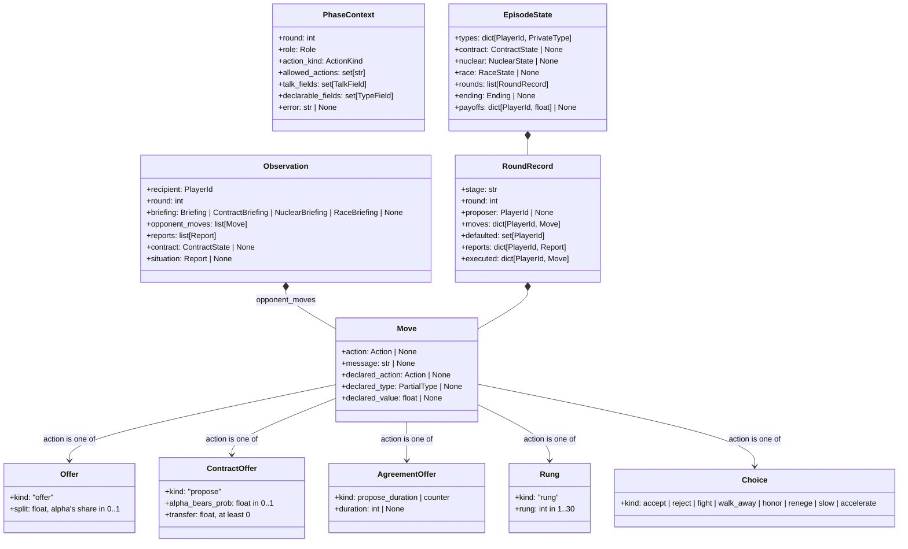

The briefings, one per game, are given only with a player's first observation:
- **`Briefing`** (crisis bargaining): `own_type`, `opponent_type` (a `PartialType`), `opponent_prior`, `private_fields`, `status_quo`, `termination`.
- **`ContractBriefing`**: `params` (all of `ContractParams`, which are public), `max_rounds`, `persuasion_rounds`.
- **`NuclearBriefing`**: the player's own worth of the territory (oil fields, towns, the pass), the range of the opponent's worth, payoffs, framing, the horizon if known, and a mid-crisis start.
- **`RaceBriefing`**: the lab's own `k` and `c`, `params`, `condition`, `wording`, and whether it proposes first.

Each game's own running state sits in `EpisodeState`: `ContractState` (the signed terms, then the shock and the bearer), `NuclearState` (territory share, oil fields, costs, whether nuclear weapons were used), and `RaceState` (the lab types, capabilities, threshold, background hazard, the agreement window, every negotiation as a `RaceNegotiation` and every round as a `RaceRound`).

The following mental models are worth keeping in mind:

- **`Observation` vs. `PhaseContext`.** An `Observation` is *what you've learned*. A `PhaseContext` is *what you're being asked to do*: your role, the exact `allowed_actions`, which talk fields are open, and why your last attempt was rejected. Players read their allowed actions from the context, never from a game table.
- **A message phase has no actions.** In a phase with `action_kind="message"`, `allowed_actions` is empty, `Move.action` must be `None`, and `Move.message` is the move itself.
- **`ContractState` is public.** It holds the signed terms and, after nature's draw, the shock and the bearer. It's attached to every observation, but it never contains the bearer's decision. That decision is a move the other player is never shown.
- **A situation is where the game stands for one player.** A game with a `SITUATIONS` rule fills `Observation.situation` with a flat dict at the moment the player is asked. The AI race uses it for the lab's capability, the threshold, the agreement window, the last verification report and the pending offer; nothing in it is hidden state, such as the rival's capability or the risk.
- **`PrivateType` vs. `PartialType`.** A `PrivateType` is a complete, true type. A `PartialType` is the same shape with holes (`None` means unknown or not stated). It's used for the opponent's public fields in a `Briefing` and for a `declared_type` claim; the AI race's statements of `k` and `c` are declared types too. Contract dynamics, the nuclear crisis and the AI race have no `priors`: `types` is empty, and the AI race keeps its lab types in `RaceState`.
- **`Action` is a discriminated union** on `kind`. Pydantic chooses `Offer` (`"offer"`), `ContractOffer` (`"propose"`), `AgreementOffer` (`"propose_duration"` and `"counter"`), `Rung` (`"rung"`) or `Choice` (every other kind) from it. The AI race's model sees "propose"; only the internal kind differs, because `ContractOffer` has it.
- **Stored values are always from alpha's side.** A split is alpha's share, and a contract's $q$ is the probability that alpha bears the cost. Only the presenters convert these to "your share" and "probability you bear". The AI race's labs are `alpha` and `beta` everywhere but in its text, where they are Lab A and Lab B.
- **Chosen vs. executed.** With the noise treatment on, a game's `NOISE` rule may change a move as it's carried out. `RoundRecord.moves` keeps the chosen move and `RoundRecord.executed` the changed one. The opponent, the ending rule and the end-of-round rule see the executed move; measures of intent keep using the chosen one. A move that noise leaves unchanged is not an accident, and default moves are never touched. (The AI race's enforcement isn't noise: `after_round` changes an attempt into Slow down and records both in its `RaceRound`.)
- **Reports are private.** A game with an end-of-round rule (`AFTER_ROUND`) tells each player what happened from its own side. A report reaches only its player, with that player's next observation, and stays in `RoundRecord.reports`. It's a flat dict: the game defines the keys and its presenter renders them.
- **`RoundRecord.moves` keeps one move per player.** A game where a player moves more than once a round (the AI race: an offer and a final answer, a declaration and an action) keeps its own record through `AFTER_PHASE`.
- **`EpisodeState` is the full record** of an episode. Measures and scorers read only this object (plus the config and probe answers).

**Type aliases:**
- `PlayerId`: `alpha` / `beta`.
- `GameId`: `crisis_bargaining` / `contract_dynamics` / `nuclear_crisis` / `ai_race`.
- `Role`: `proposer` / `responder` / `bearer` / `other` / `both`.
- `ActionKind`: `offer` / `response` / `message` / `decision` / `rung` / `final` / `declaration` / `action`.
- `TypeField`: `capability` / `cost_of_conflict` / `k` / `c`.
- `TalkField`: `message` / `declared_action` / `declared_type` / `declared_value`.
- `Report`: a flat dict of strings, numbers and booleans, with keys the game defines.
- `Ending`, for crisis bargaining: `agreement`, `fight`, `random_stop`.
- `Ending`, for contract dynamics: `walked_away`, `no_shock`, `honored`, `reneged`.
- `Ending`, for the nuclear crisis: `knockout`, `strategic_war`, `ceasefire`.
- `Ending`, for the AI race: `catastrophe`, `random_stop`.
- `Ending`, for all: `horizon`.

## 4. The referee (`referee.py`)

### 4.1 The episode loop

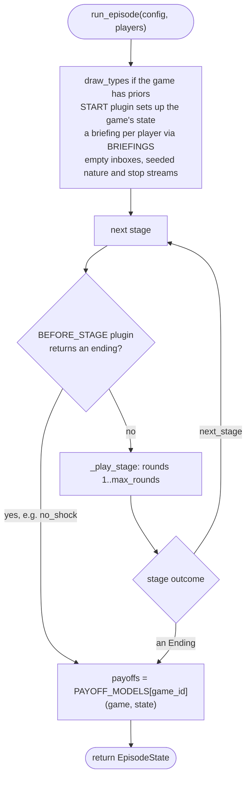

Inside `_play_stage`, each round runs the stage's phases, skipping any that the game's `OPEN_PHASES` rule closes for this round. After every phase, the game's `AFTER_PHASE` rule, if it has one, sees the phase's moves. After every move, `ENDING_RULES` may return an `Ending` (the episode is over) or `"next_stage"` (for example, `accept` in contract dynamics). Once every phase of a round is played, a game's `AFTER_ROUND` rule, if it has one, returns a `RoundEnd`: a private report for each player and, optionally, an outcome that ends the episode or the stage. That's how a game ends on its own state rather than on a single move. If nothing ends the round, the referee draws the random stop between rounds, and a stage that runs out of rounds returns its `when_exhausted` value.

The referee has four separate seeded streams, so changing one kind of draw never shifts the others:
- types: `draw_types` with `seed`;
- nature: `random.Random(f"nature-{seed}")`, which draws the shock first and then the bearer;
- random stops: `random.Random(f"random_stop-{seed}")`;
- noise: `random.Random(f"noise-{seed}-{stage}-{round}-{player}")`, one per move, so one player's accidents never depend on the other's moves, and both episodes of a pair get the same accidents.

Games may keep streams of their own. The AI race draws everything from `f3_game.rng(purpose, seed, keys...)`: types, the first proposer, and per round the background hazard, the catastrophe, each lab's verification signal (keyed by the lab as `A` or `B`) and the stop. It sets the stage's `stop_prob` to 0 and makes its stopping draw in `after_round`.

### 4.2 Who acts in a phase

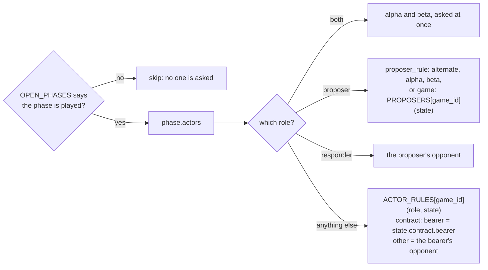

The proposer is fixed at the start of the round. With `proposer_rule="game"`, the AI race names it from its state: drawn at random for the first negotiation, then alternating from one negotiation to the next.

### 4.3 One phase, seen from a player

Before a player acts, the referee empties that player's **inbox**: every opponent move since the player last acted. It also empties the player's **reports**: what the game's end-of-round rule told it since then. The first observation also carries the **briefing**, every observation carries the current public `ContractState`, if there is one, and the game's **situation** for this player, if the game has a `SITUATIONS` rule.

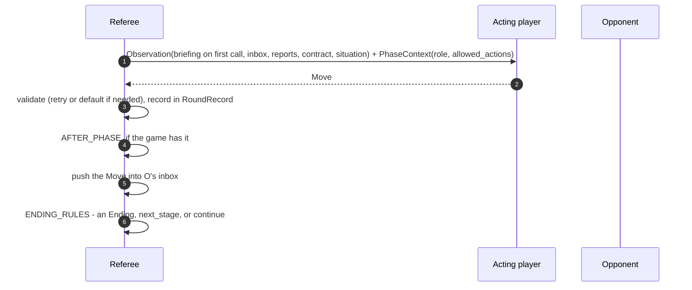

In a phase with `actors="both"`, the referee asks both players at once. Each observation is built before any move of the phase is in, so neither player sees the other's move until the next phase or round; both moves then enter the inboxes together, and `ENDING_RULES` runs once both are in, alpha's move first. Retries and default moves work per player, so a player that fails doesn't hold up the other. The players who defaulted in a phase reach `AFTER_PHASE` in the order their requests ended.

Default moves are also chosen **per player**. `run_episode` takes an optional `default_moves` dict from player to default-move function; a player without an entry falls back to the game's `DEFAULT_MOVES[game_id]`. The commitment stage uses this to wrap the game's default so that a committed delegate's default offer never falls below its floor, without the referee knowing anything about floors.

In contract dynamics, the bearer's decision is the last move of the episode. It goes into the other player's inbox, but that inbox is never delivered, so the other player never sees the decision. In the AI race, a lab's action also enters the rival's inbox, but its presenter never shows it: what a lab learns about the rival's action comes only from the verification report, through its situation.

### 4.4 Getting a valid move: retries and default moves

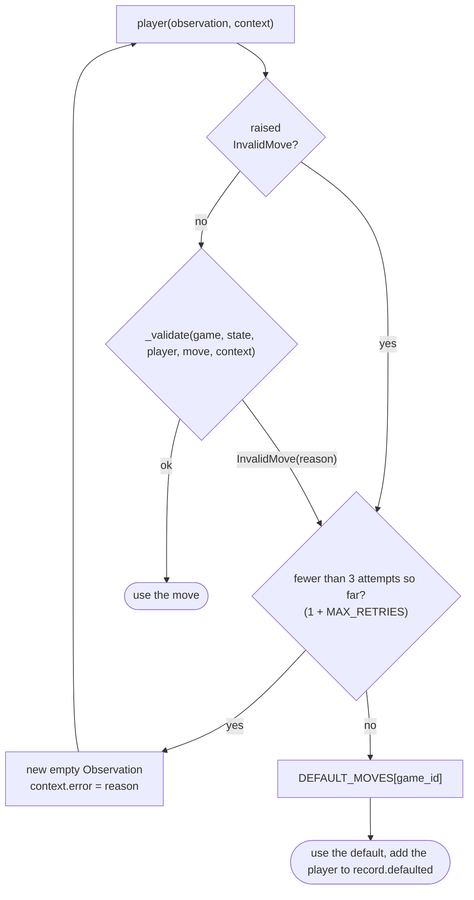

`_validate` checks five things, in order:
1. **Action.** The action is present and its kind is in `context.allowed_actions`. In a message phase, there must be no action.
2. **Talk.** Every talk field used is in `context.talk_fields`. In a message phase, `message` is always open.
3. **Declared type.** It only states fields in `context.declarable_fields`, which are the private ones.
4. **Game rules.** `MOVE_CHECKS[game_id]` returns no problem. For contract dynamics, that's the transfer cap.
5. **Rules of the game so far.** `STATE_CHECKS[game_id]` returns no problem, given the state and the player. For the nuclear crisis, that's the climb limit; for the AI race, the duration's range, a counter that differs from the offer, and positive stated `k` and `c`.

Players can fail in two ways, and both go through the same retry path. Either the referee rejects the move, or the player raises `InvalidMove` itself, which is what `model_player` does when a tool call is missing or malformed, or lacks a field the tool requires. After a default move, `model_player` tells the model, in the next round, that its last move was not accepted, unless the presenter turns that off (contract dynamics and the AI race do).

Default moves per game:

| Phase | Crisis bargaining | Contract dynamics | Nuclear crisis | AI race |
|---|---|---|---|---|
| Proposer | Repeat its last offer, or offer the status quo | Repeat its last proposal, or propose $(\tfrac12, 0)$ | | Propose no agreement |
| Responder, final answer | `reject` | `reject` | | `reject` |
| Message | (none) | An empty message | | |
| Decision | (none) | `renege`. The honoring measures exclude defaulted decisions | | |
| Each round | | | Hold the last rung, announced | Slow down, in the declaration and the action |

### 4.5 Plugin dicts and other constants

| Name | Maps `game_id` to | Crisis bargaining | Contract dynamics | Nuclear crisis | AI race |
|---|---|---|---|---|---|
| `ALLOWED_ACTIONS` | `ActionKind -> set of kinds` | offer: `{offer, fight}`; response: `{accept, reject, fight}` | offer: `{propose, walk_away}`; response: `{accept, reject, walk_away}`; message: `{}`; decision: `{honor, renege}` | rung: `{rung}` | offer: `{propose_duration}`; response: `{accept, reject, counter}`; final: `{accept, reject}`; declaration and action: `{slow, accelerate}` |
| `BRIEFINGS` | `(config, state, player) -> briefing` | `briefing` | `briefing` | `briefing`: the player's own worth | `briefing`: the lab's k and c |
| `ENDING_RULES` | `(Move) -> Ending \| "next_stage" \| None` | accept means agreement, fight means fight | accept means `next_stage`; `walk_away`, `honor` and `renege` end the episode | none: the state ends it, in `after_round` | none: rounds end in `after_round` |
| `PAYOFF_MODELS` | `(GameSpec, EpisodeState) -> payoffs` | `episode_payoffs` | `episode_payoffs` | `episode_payoffs` | `episode_payoffs`: the sum of round payoffs |
| `DEFAULT_MOVES` | `(GameSpec, EpisodeState, PlayerId, PhaseContext) -> Move` | `default_move` | `default_move` | `default_move`: hold the last rung | `default_move`: no agreement, reject, Slow down |
| `START` (optional) | `(EpisodeConfig, EpisodeState) -> None`, sets up the game's state before the briefings | (absent) | (absent) | (absent) | `start`: types, first proposer, seed |
| `BEFORE_STAGE` (optional) | `(GameSpec, EpisodeState, StageSpec, Random) -> Ending \| None` | (absent) | `before_stage`: before `persuasion`, records the contract and draws shock and bearer | `before_stage`: sets up the territory, or a mid-crisis start | (absent) |
| `PROPOSERS` (optional) | `(EpisodeState) -> PlayerId`, for stages with `proposer_rule="game"` | (absent) | (absent) | (absent) | `proposer`: drawn at random, then alternating per negotiation |
| `OPEN_PHASES` (optional) | `(GameSpec, EpisodeState, RoundRecord, PhaseSpec) -> bool`; a closed phase asks no one | (absent) | (absent) | (absent) | `phase_open`: renegotiation only outside an agreement, replies only while a negotiation is open |
| `SITUATIONS` (optional) | `(GameSpec, EpisodeState, RoundRecord, PhaseSpec, PlayerId) -> Report`, shown as `Observation.situation` | (absent) | (absent) | (absent) | `situation`: capability, threshold, agreement, report, override, pending offer |
| `MOVE_CHECKS` (optional) | `(GameSpec, Move) -> problem \| None` | (absent) | `move_problem`: the transfer cap | `move_problem`: announcements are rungs | (absent) |
| `STATE_CHECKS` (optional) | `(GameSpec, EpisodeState, PlayerId, Move) -> problem \| None` | (absent) | (absent) | `climb_problem`: at most three rungs above the last executed one | `move_problem`: the duration's range, a counter that differs, positive stated k and c |
| `ACTOR_RULES` (optional) | `(Role, EpisodeState) -> PlayerId` | (absent) | `actor_for`: bearer and other | (absent) | (absent) |
| `AFTER_PHASE` (optional) | `(GameSpec, EpisodeState, RoundRecord, PhaseSpec, moves, defaulted) -> None`, for games where a player moves more than once a round | (absent) | (absent) | (absent) | `after_phase`: records negotiations and declarations |
| `AFTER_ROUND` (optional) | `(GameSpec, EpisodeState, RoundRecord) -> RoundEnd` | (absent) | (absent) | `after_round`: territory, costs, burning oil, reports, endings | `after_round`: enforcement, update, risk, payoffs, signals, catastrophe and stopping draws |
| `NOISE` (optional) | `(GameSpec, EpisodeState, PlayerId, Move, Random) -> Move`, the move as carried out when the noise treatment hits | (absent) | (absent) | `misfire`: one to three rungs harsher | (absent) |

The optional dicts are read with `.get`, so a game without nature, extra roles or extra phases simply has no entry, and runs exactly as it would without the hook. Other constants: `MAX_RETRIES = 2` and `TALK_FIELDS`.

## 5. The game rules

Each game module has the same layers: pure formulas, then engine plugins built on them.

### 5.1 Crisis bargaining (`crisis_bargaining.py`)

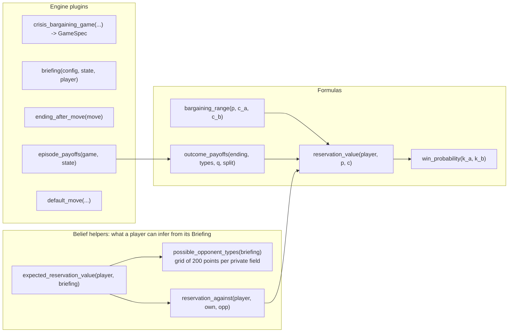

The belief helpers are shared by the Equilibrium Bot (its decisions) and the comprehension probe (its ground truth). That way "what the player should know" is defined in exactly one place.

### 5.2 Contract dynamics (`contract_dynamics.py`)

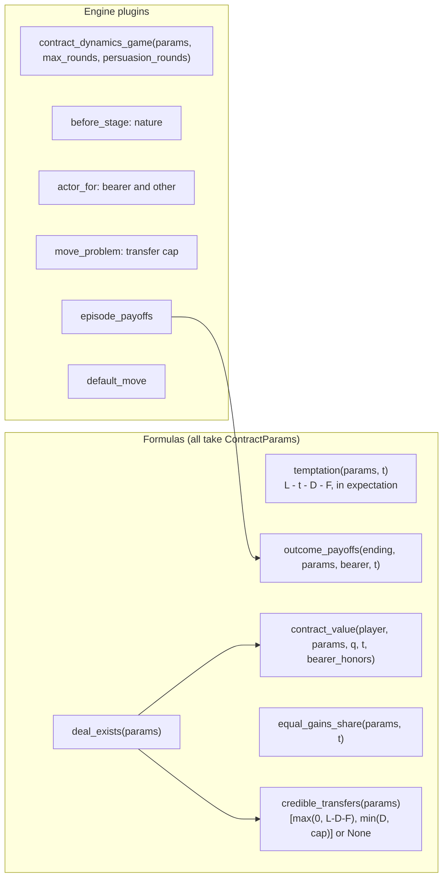

These formulas are used in three places:
- by the **rational bot**, to decide;
- by the **measures**: `temptation` for the failure types, `equal_gains_share` for the deviation, and `deal_exists` for missed deals;
- by the **tests**, which check them against the spec's worked example.

### 5.3 Nuclear crisis (`nuclear_crisis.py`)

The ladder (`LADDER`) is Payne's 30 rungs, mildest first. A rung's value drives the territory shift and the costs; `effective_value` gates the strategic threats until someone has crossed the tactical nuclear threshold. Each round, `climb_problem` keeps a side within three rungs of where it stood, `misfire` (with the noise treatment) carries an order out one to three rungs harsher, and `after_round` shifts the territory toward the harsher side, charges both sides for the hottest rung, burns oil fields under heavy fighting, writes each side's private report, and ends the game by knockout, strategic war or ceasefire. The exact rules are in [nuclear-crisis-formal.md](nuclear-crisis-formal.md).

### 5.4 AI race (`f3_game.py`)

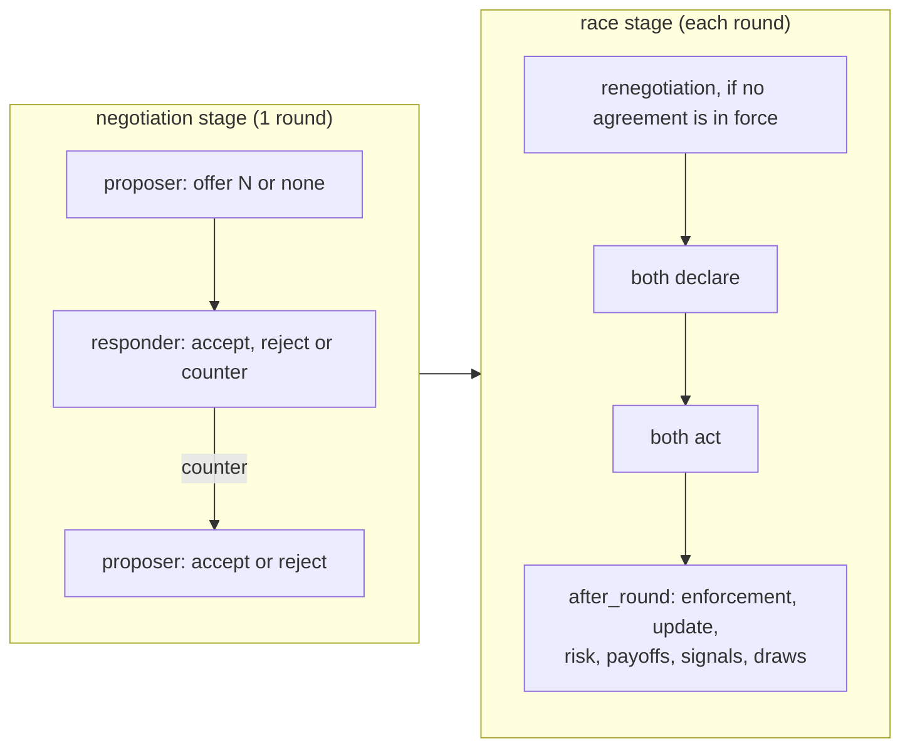

`after_phase` builds each `RaceNegotiation` move by move and signs an agreement when one is reached; it starts with the round after its negotiation. `after_round` turns attempts into actions (an attempt to accelerate becomes Slow down under an enforced agreement), raises capabilities, computes the frontier distance and risk ($p = 1 - e^{-(\kappa D + b)}$), the payoffs, and the verification reports, then draws the catastrophe and the stop from the game's own streams.

## 6. Players

### 6.1 Bots (`bots.py`, `nuclear_bots.py`, `f3_bots.py`)

Each bot is a **closure**: a factory function returns an `async play(observation, context)`, which keeps the bot's private memory between calls.

| Factory | Game | Memory | Behavior |
|---|---|---|---|
| `random_bot(seed)` | crisis | a seeded `random.Random` | Picks uniformly from `context.allowed_actions`; offers are uniform splits |
| `equilibrium_bot()` | crisis | its `Briefing` | Proposer: `_risk_return_share` against the opponent grid, breaking ties toward the most generous. Responder: accepts at or above `expected_reservation_value`, otherwise fights. Truthful declared types |
| `rational_contract_bot()` | contract | its `ContractBriefing` | Proposer: walks away if `deal_exists` is false; otherwise `_best_credible_contract`, which scans 101 credible transfers and picks the $(q^*(t), t)$ that maximizes the smaller side's value. Responder: accepts iff `contract_value` > 0, assuming the bearer honors iff $\tau \le 0$; otherwise walks away. Bearer: honors iff $\tau \le 0$. Sends empty messages |
| `scripted_contract_bot(decision, appeal)` | contract | none | Proposes $(\tfrac12, 0)$, accepts anything, sends `appeal` as the other player, and always makes `decision` as bearer. The task exposes it as `always_honor` and `always_renege` |
| `nuclear_bot(kind, seed, start)` | nuclear | its current rung | The F2 bots: `calm` holds Initial Diplomatic Pressure; `strike`, `jump`, `rollback` and `explanation` start from the seed's rung and climb one to three rungs in rounds 5, 10 and 15, announced (strike) or not (the others). `jump` stays up, `rollback` and `explanation` return the next round; `truce` strikes, steps back to Return to Start Line the round after and climbs back three rungs a round. No bot climbs more than three rungs a round. `start` picks up a mid-crisis start |
| `always_slow`, `always_accelerate`, `secret_defector`, `tit_for_tat` | AI race | `tit_for_tat`: the rival's last declaration | Propose N = 6 and accept any agreement (`always_accelerate`: propose none and accept none). `secret_defector` declares Slow down and accelerates; `tit_for_tat` slows down in round 1, then copies the rival's last report, or else its last declaration |
| `f3_bots.random_bot(seed)`, `scripted(strategy)` | AI race | a seeded `random.Random`; none | Uniform options and durations; a fixed per-round strategy that never agrees (for calibration) |

### 6.2 The model player (`model_player.py`) and presenters

`model_player(model, probe_log, presenter)` is also a closure. Its memory is:
- the model's **persistent conversation**;
- the tools list, fixed on the first call;
- the IDs of tool calls still waiting for a result;
- the last `ContractState` it rendered, so contract news is shown only once.

```mermaid
sequenceDiagram
    autonumber
    participant R as Referee
    participant MP as model_player
    participant PR as Presenter
    participant M as Inspect Model
    R->>MP: play(observation, context)
    MP->>MP: system prompt on the first call, tool results for pending calls
    MP->>PR: render(me, observation, context)
    PR-->>MP: text, added as a user message
    MP->>PR: probes(ask, me, observation, context)
    PR->>M: ask(question) - generate on a COPY of messages + question, same tools
    M-->>PR: answer_probe(answer)
    PR-->>MP: ProbeResponses, added to probe_log. The copy is discarded
    MP->>M: generate(messages, tools) - the tools fixed on the first call
    M-->>MP: assistant message with a submit_move tool call
    MP->>MP: raise InvalidMove if not exactly one submit_move call, or a required field is missing
    MP->>PR: parse(me, arguments, context)
    PR-->>MP: Move, or raise InvalidMove
    MP->>PR: after_move(ask, me, observation, context), if the presenter has it; on a retry, the round's first observation
    PR->>M: ask(question) - on a COPY of messages + the move's tool results, nothing new shown
    M-->>PR: answer_probe(answer)
    PR-->>MP: ProbeResponses, added to probe_log
    MP-->>R: Move
```

A `Presenter` is a frozen dataclass of five plain values (`system_prompt`, `render`, `tool`, `parse`, `probes`), plus optional settings:

| Field | Crisis bargaining | Contract dynamics | Nuclear crisis | AI race |
|---|---|---|---|---|
| `system_prompt` | Rules of alternating offers and fighting | Rules of the two stages, in the setting's story; says the interaction is one-shot and anonymous | Short and framing-free; the rules come with the briefing | The full rules in the chosen wording; names the lab, so the presenter is built per lab |
| `render` | Types, priors, status quo, horizon; the opponent's offers as "offer you X of the stake" | Explicit payoff table, benefits, $p$, transfer regime, an enforcement statement ("a promise, not a lock" when $F = 0$); proposals as "you bear with probability X"; contract news; the current task | Military or neutral opening and rules, the ladder by name and description, and the player's worth; then each round from its own side, its own accident included, in the framing's words | The lab's k and c; the negotiation; each round's capability, threshold, agreement and report; the rival's declaration before the action |
| `tool` | One schema for the whole episode: every action (`accept`, `fight`, `offer`, `reject`), `own_share`, plus the talk and `declared_*` fields the treatments open | One schema for the whole episode: every action (in the setting's labels), `probability_you_bear`, `transfer` (when transfers are allowed), `message`, plus `promise` when open | The option taken, plus `announced`, `claimed_worth` and `message` when open | `action`, `duration`, `message`, `stated_k`, `stated_c` |
| `parse(me, arguments, context)` | `own_share` to alpha's `split` | `probability_you_bear` to `alpha_bears_prob`; the setting's labels to `honor` and `renege`; `promise` to `declared_action` | option names to `Rung`s; `claimed_worth` to `declared_value` | `propose` to `AgreementOffer`; `stated_k` and `stated_c` to `declared_type`; in a round, only the action |
| `probes(ask, me, observation, context)` | Comprehension (own expected fight payoff), once after the briefing, with its ground truth | Belief ($\pi$) before each response to an offer; the persuader's belief before each message; comprehension (own payoff from reneging) before the decision | The territory's worth and trust in the opponent (0-100) before every move; after an opponent's climb, strike or accident with a confidence | Three comprehension questions with the briefing, through `ask.with_tool` and its own answer tool |
| `after_move` (optional, default none) | | | On rounds 1, 4, 7, ...: the worth right after the claim, and the same sum asked fresh | |
| `answer_tool` (default `ANSWER_PROBE_TOOL`) | the default | the default | `ANSWER_WITH_CHOICE_TOOL` | `None`: `submit_move` is the only tool |
| `error` (default: unchanged) | | the setting's labels in place of internal action names | | |
| `announce_default` (default on) | on | off | on | off |
| `repeat_reminder` (default on) | on | off | on | on |
| `ignore_stray_calls` (default on) | on | on | on | off: anything but exactly one `submit_move` call is invalid |
| `check_required` (default on) | on | on | on | off: its parser reports missing arguments |
| `debrief` (optional) | | | | The post-game interview |

The settings exist so that each game keeps exactly the conversation it was designed and run with; the contract values are those of the branch its runs were made on, and the AI race's are those of its original adapter.

**Four ways to ask.** The `ask` a probe receives is callable: `await ask(question)` asks on a copy of the conversation and returns a number. `ask.choice(question, options)` also returns the option the model picked; it needs `ANSWER_WITH_CHOICE_TOOL` as the presenter's answer tool. `ask.fresh(question)` asks in a new conversation, with no role and no game history and only the answer tool. `ask.with_tool(question, tool)` asks on a copy with a tool of the presenter's own and returns its arguments; it's only safe before the model's first move. Probes in `after_move` ask on a copy where the move's tool calls are already answered, as if the move were accepted, before the player is shown anything new. The model player stamps every answer with the round of its move.

**Post-game questions.** With a `debrief`, the model player gets a `debrief(state)` coroutine. After the episode, the solver asks it on a copy of the conversation, with the same tools offered but none allowed (`tool_choice="none"`), and the game's `DEBRIEFS` rule turns the reply into what is stored.

Two rules about tools, each checked by a test:

- **One tools list per conversation.** The list is `[submit_move, answer_probe]` (the presenter's `answer_tool`; just `[submit_move]` when it is `None`), computed on the first call and then reused for every move, every probe and the debrief. Models with extended thinking return signed reasoning that is bound to the tools list it was created with, so changing the list mid-conversation makes the API reject the request (ADR 0001, amended). The current options are therefore stated in the rendered text (for example, "Your options: offer, fight."), not in the schema, and the referee rejects anything that isn't open. The one exception is `ask.with_tool`, used only before the first move, when there is no earlier reasoning to bind.
- **Every tool call gets a matching tool result** before the next generate. With `ignore_stray_calls` on, a stray `answer_probe` call made alongside a move is answered with "Ignored" and doesn't invalidate the move; with it off, every call is answered as a move.

## 7. The Inspect shell (`task.py`, `contract_task.py`, `nuclear_task.py`, `f3_task.py`)

Every task uses the shared `referee()` solver. Two dicts in `task.py` hold what only some games do: `DEBRIEFS` (games that interview model players after the episode; the AI race stores the replies under `interviews`) and `TRANSCRIPTS` (games with a public transcript of their own; the AI race keeps the format it always had).

### 7.1 From parameters to metrics

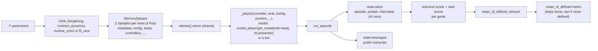

| | Crisis bargaining | Contract dynamics | Nuclear crisis | AI race |
|---|---|---|---|---|
| Task | `crisis_bargaining` in `task.py` | `contract_dynamics` in `contract_task.py` | `nuclear_crisis` in `nuclear_task.py` | `f3_race` in `f3_task.py` |
| Controllers | `model`, `equilibrium`, `random` | `model`, `rational`, `always_honor`, `always_renege` | `model`, `calm`, `strike`, `jump`, `rollback`, `explanation`, `truce` | `model`, `always_slow`, `always_accelerate`, `tit_for_tat`, `secret_defector`, `random` |
| Outcome scorer | `outcome_scorer` from `outcome_measures` | `contract_outcome_scorer` from `contract_outcome_measures` | `nuclear_outcome_scorer` from `nuclear_outcome_measures` | `outcome_scorer` from `f3_measures.outcome_measures` |
| Seat scorer | `seat_scorer`: `player_measures` plus comprehension | `contract_seat_scorer`: `contract_player_measures`, plus comprehension, belief, belief error and the persuader's belief from the probes | `nuclear_seat_scorer`: `nuclear_player_measures`, plus worth, claim and strike-or-accident measures from the probes | `seat_scorer`: payoff, comprehension (all three questions right) and understanding (from the interview) |

### 7.2 Seats vs. positions

Positions (`alpha` and `beta`) belong to the game. Seats (`a` and `b`) belong to the experiment, and each one maps to a controller and a model role. Each Pair swaps the mapping between them:

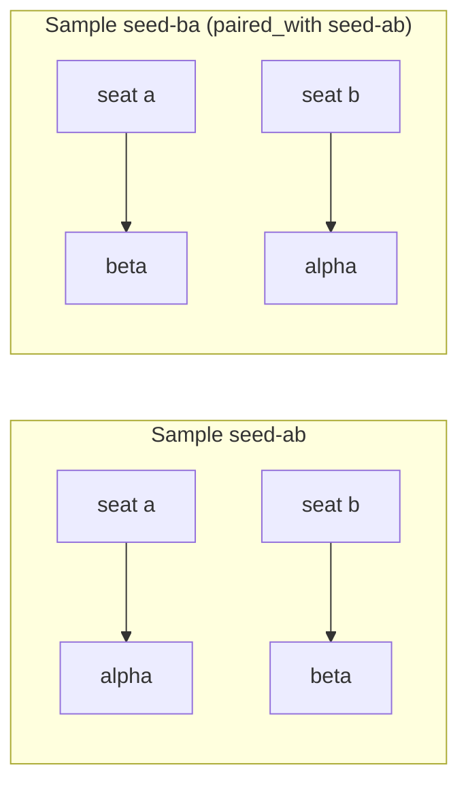

The seat scorers convert per-position measures back to seats (`a_...`, `b_...`), so each metric stays tied to the same model across the pair. In contract dynamics, benefits belong to positions. So when $b_\alpha \ne b_\beta$, each seat plays once with each benefit, which is what the fairness split (`honored_with_smaller_reward` vs. `_larger_reward`) relies on.

### 7.3 Why there's a custom reducer

Inspect always applies an epoch reducer, and the default one turns `None` into `0`. `None` means "not defined for this episode", for example `in_range` when there was no agreement, or `honored` when no shock hit. If those values became zeros, the averages would be wrong. `mean_of_defined_reducer` and the `mean_of_defined` metric skip `None` instead.

## 8. Where measures come from (`measures.py`, `f3_measures.py`)

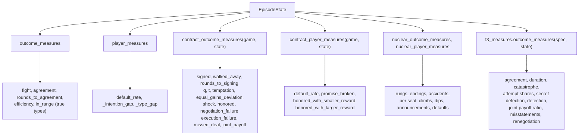

The probe-based measures are computed in the task modules:
- **Comprehension:** each task's `_comprehension`. The tolerance is 0.01; the contract ground truth is $b_i - D - F$, and the AI race needs all three questions right.
- **Belief, belief error and the persuader's belief:** `contract_task`.
- **Worth, claims and strike-or-accident answers:** `nuclear_task._probe_measures`.
- **Understanding:** `f3_task._understanding`, from the interview's two factual questions.

## 9. Adding things

**A new bot.** Write a factory that returns `async play(observation, context) -> Move`, in the game's bots module. Read allowed actions from `context.allowed_actions`. Then add it to `Controller` and `_player` in `task.py`.

**A new treatment.** Follow these steps:
1. Add a parameter model to `schema.py` and an optional field on `Treatments` (`None` means off). A game-specific number can go into that game's params instead, the way contract dynamics, the nuclear crisis and the AI race do.
2. Apply it in the referee or the game's plugins. Information treatments go in the game's `briefing`, and permissions go in `PhaseContext`, `_validate`, `MOVE_CHECKS` or `STATE_CHECKS`.
3. Render it in the game's presenter.
4. Expose it as a task parameter.

**A new game** (ADRs 0002 to 0004). Follow these steps:
1. Add its id to `GameId`, and its new roles, action kinds, actions and endings to the aliases in `schema.py`; its parameters and running state go on `GameSpec` and `EpisodeState`.
2. Write a rules module: a `GameSpec` factory (its stages), `ALLOWED_ACTIONS`, `briefing`, an ending rule, a payoff model and a default move. Add the optional rules it needs: `start`, `before_stage`, `actor_for`, a proposer rule, `phase_open`, `after_phase`, `situation`, `move_problem` or a state check, `after_round`, `misfire`.
3. Register these in the referee's plugin dicts.
4. Write a presenter and wire it into `_presenter` in `task.py`; set the presenter's settings if its conversation should differ from the default.
5. Write a task module with its scorers.

**Simultaneous moves.** Give a phase `actors="both"` (section 4.3). The nuclear crisis and the AI race use it; the divisible contract arm can too.

## 10. Tests

Each game is tested at the same seams: its rules, episodes played through the referee with scripted players, its bots, its measures, and its task end to end. Only the last touches Inspect, and it uses the `mockllm` model, so the suite never calls a real API.

Engine features are tested in `test_engine.py` with a toy game that is registered in the plugin dicts only for those tests. `test_model_player.py` tests the model player's probes, default-move notices and reminders with a bare presenter.

| Seam | Crisis bargaining | Contract dynamics | Nuclear crisis | AI race |
|---|---|---|---|---|
| 1. Game rules | `test_crisis_bargaining_rules.py`, `test_outcome_payoffs.py` | `test_contract_rules.py`, `test_contract_uncertain_costs.py` | `test_nuclear_crisis.py` | `test_f3_game.py` |
| 2. Type drawing / engine | `test_draw_types.py` | `test_engine.py` | `test_engine.py` | `test_f3_game.py` (matched draws) |
| 3. Referee | `test_referee.py` | `test_contract_referee.py`, `test_contract_fixed_bearer.py`, `test_contract_fixed_transfer.py` | `test_nuclear_crisis.py` | `test_f3_game.py` |
| 4. Bots | `test_equilibrium_bot.py`, `test_random_bot.py` | `test_contract_bots.py` | `test_nuclear_bots.py`, `test_nuclear_twins.py` | `test_f3_game.py` (calibration numbers) |
| 5. Measures | `test_measures.py` | `test_contract_measures.py` | `test_nuclear_measures.py` | `test_f3_game.py` |
| 6. Presenter and Inspect end to end | `test_task.py` | `test_contract_task.py`, `test_contract_framing.py`, `test_contract_presenter_text.py` | `test_nuclear_crisis.py`, `test_nuclear_check.py` | `test_f3_game.py` (prompt snapshot, tool schema) |

Two kinds of test guard reproducibility in particular: the tool-schema tests (one tools list per conversation) and the AI race's prompt snapshot (`tests/snapshots/wording_labs.txt`). The pilot scripts are tested in `test_pilot_scripts.py`.
