# Architecture

How the code in `src/spar_harness/` is organized: its modules, types and functions, and how they connect. For the games themselves, see [crisis-bargaining-formal.md](crisis-bargaining-formal.md), [contract-dynamics-formal.md](contract-dynamics-formal.md) and [nuclear-crisis-formal.md](nuclear-crisis-formal.md).

## 1. The big picture

Keep five ideas in mind, and the rest of the code follows from them.

1. **The referee is the only authority.** It's a deterministic loop that owns the episode state. It asks players for moves, validates them, makes nature's draws, decides when the episode ends, and computes payoffs. Players never touch the state.
2. **A player is just a function.** Bots and models share one signature, `async (Observation, PhaseContext) -> Move`. The referee can't tell them apart, so it can be tested entirely with bots, for free.
3. **A game is a sequence of stages, and its rules are plugins.** The engine runs stages of repeated phases. Everything specific to a game (which actions exist, when it ends, payoffs, default moves, nature, extra roles) is looked up in plain dicts keyed by `game_id`.
4. **A presenter is how a game looks to a model.** The model player is game-agnostic. A `Presenter` per game supplies the prompt, the text rendering, the tool schema, the argument parsing and the probes.
5. **Inspect is a thin outer shell.** It only turns conditions into samples, model roles into players, and episode records into scores. Everything inside `run_episode` works without Inspect.

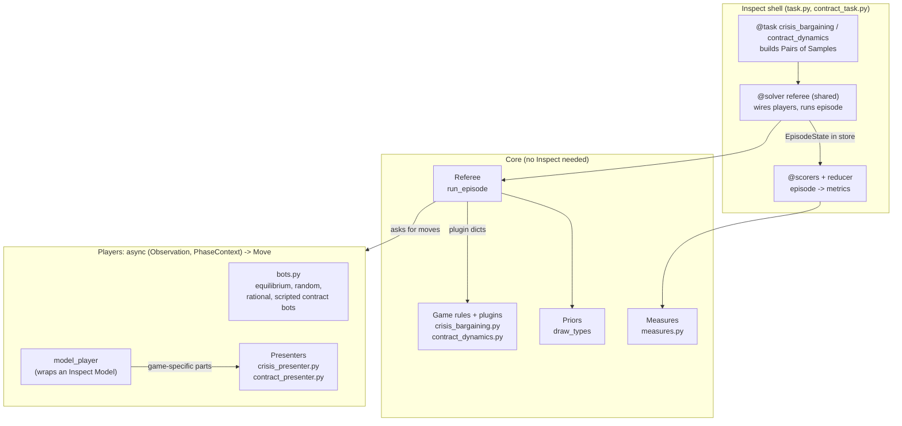

## 2. Modules

| Module | What it is | Main public names |
|---|---|---|
| `schema.py` | All shared types: pydantic models and `Literal` aliases. No logic | `EpisodeConfig`, `GameSpec`, `StageSpec`, `ContractParams`, `Treatments`, `Move`, `Observation`, `PhaseContext`, `EpisodeState` |
| `crisis_bargaining.py` | Crisis bargaining: pure rules plus the game's plugins | `win_probability`, `reservation_value`, `bargaining_range`, `outcome_payoffs`, `crisis_bargaining_game`, `ALLOWED_ACTIONS`, `briefing`, `ending_after_move`, `episode_payoffs`, `default_move`, `expected_reservation_value` |
| `contract_dynamics.py` | Contract dynamics: pure rules plus the game's plugins | `temptation`, `outcome_payoffs`, `contract_value`, `equal_gains_share`, `credible_transfers`, `deal_exists`, `contract_dynamics_game`, `ALLOWED_ACTIONS`, `briefing`, `ending_after_move`, `default_move`, `move_problem`, `before_stage`, `actor_for`, `episode_payoffs` |
| `priors.py` | Seeded type drawing | `draw_types` |
| `referee.py` | The general stage engine | `run_episode`, `Player`, `InvalidMove`, the plugin dicts |
| `bots.py` | Scripted players for both games | `equilibrium_bot`, `random_bot`, `rational_contract_bot`, `scripted_contract_bot` |
| `model_player.py` | Game-agnostic adapter from an Inspect `Model` to a `Player`: conversation, the fixed tools list, retries, side-call probes | `model_player`, `Presenter`, `ProbeResponse`, `Ask`, `ask_probe`, `ANSWER_PROBE_TOOL`, `ANSWER_WITH_CHOICE_TOOL` |
| `nuclear_crisis.py` | Nuclear crisis: Payne's ladder, pure rules plus the game's plugins | `LADDER`, `is_nuclear_use`, `effective_value`, `territory_worth`, `share_payoff`, `draw_world`, `nuclear_crisis_game`, `ALLOWED_ACTIONS`, `briefing`, `ending_after_move`, `default_move`, `move_problem`, `before_stage`, `after_round`, `misfire`, `episode_payoffs` |
| `crisis_presenter.py`, `contract_presenter.py`, `nuclear_presenter.py` | How each game is shown to a model | `CRISIS_PRESENTER`, `CONTRACT_PRESENTER`, `NUCLEAR_PRESENTER` |
| `measures.py` | Per-episode measures for both games, computed from an `EpisodeState` | `outcome_measures`, `player_measures`, `contract_outcome_measures`, `contract_player_measures` |
| `task.py` | The crisis bargaining task and its scorers, plus the shared solver, reducer and metric | `crisis_bargaining`, `referee`, `mean_of_defined`, `mean_of_defined_reducer`, `Controller`, `PRESENTERS` |
| `contract_task.py` | The contract dynamics task and its scorers | `contract_dynamics`, `contract_outcome_scorer`, `contract_seat_scorer` |
| `__init__.py` | The `main()` stub left over from project scaffolding (unused) | |

### Import graph

Arrows point from a module to the modules it imports. Dependencies only flow downward, and `schema` sits at the bottom. The game modules never import the referee, which is why `move_problem` returns a problem string instead of raising `InvalidMove`.

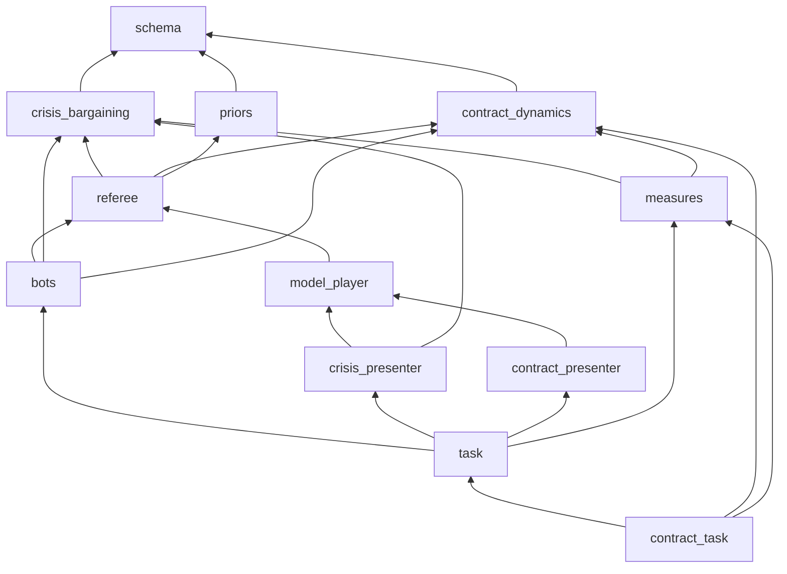

Every module also imports `schema`; those arrows are left out to keep the graph readable.

## 3. Data model (`schema.py`)

The types fall into two groups. **Configuration** is fixed before an episode starts. **Runtime** types are produced while it runs.

### 3.1 Configuration: what an episode *is*

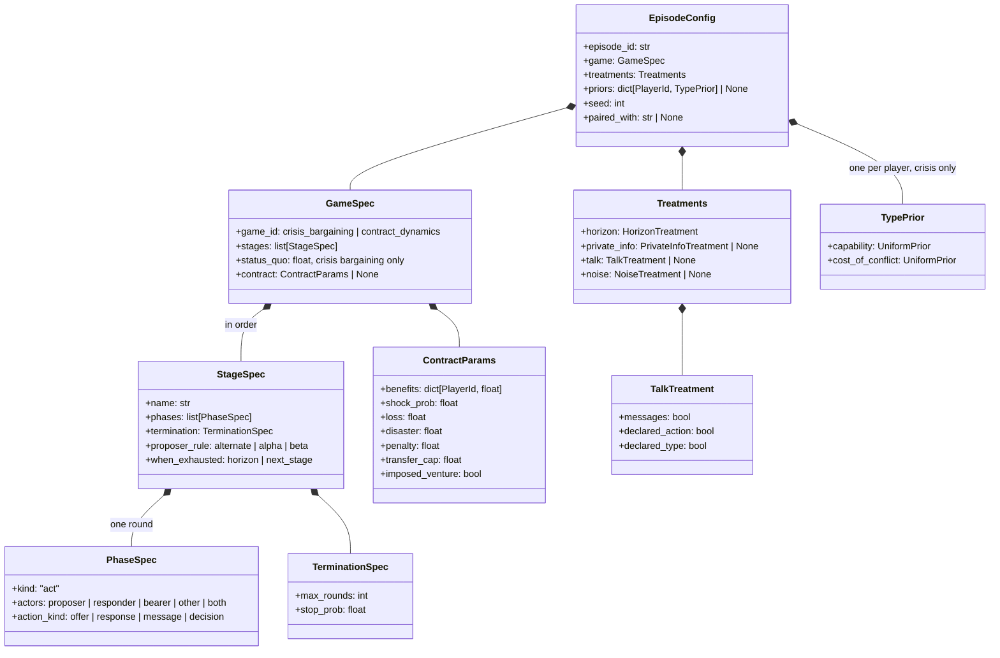

`HorizonTreatment(known)`, `PrivateInfoTreatment(private_fields)`, `NoiseTreatment(rate)` and `UniformPrior(low, high)` are left out of the diagram; their fields are given in the parentheses.

The games, expressed as stages:

| Game | Stages (phases per round) | Ran out of rounds |
|---|---|---|
| Crisis bargaining | `bargaining`: proposer `offer`, responder `response`, up to `max_rounds` with `stop_prob` | `horizon` |
| Contract dynamics | `bargaining`: proposer `offer`, responder `response` | `horizon` (no contract) |
| | `persuasion`: other `message`, bearer `message`, for $K$ rounds ($K$ may be 0) | `next_stage` |
| | `decision`: bearer `decision`, 1 round | never: honor and renege both end the game |
| Imposed venture | `persuasion`, `decision`; there is no `bargaining` stage | |
| Nuclear crisis | `crisis`: both `rung`, up to `max_rounds` (20); the round-end rule ends it by knockout, strategic war or ceasefire | `horizon` |

**Toggle convention:** a treatment that is `None` is **off**. A parameter object turns it on. `horizon` is the exception: it is always present, because the horizon is always either known or unknown. Contract treatments are numbers in `ContractParams` (for example, "no transfers" is `transfer_cap = 0`), not `Treatments` fields, and so are the nuclear crisis's payoffs and framing in `NuclearParams`.

### 3.2 Runtime: what happens during an episode

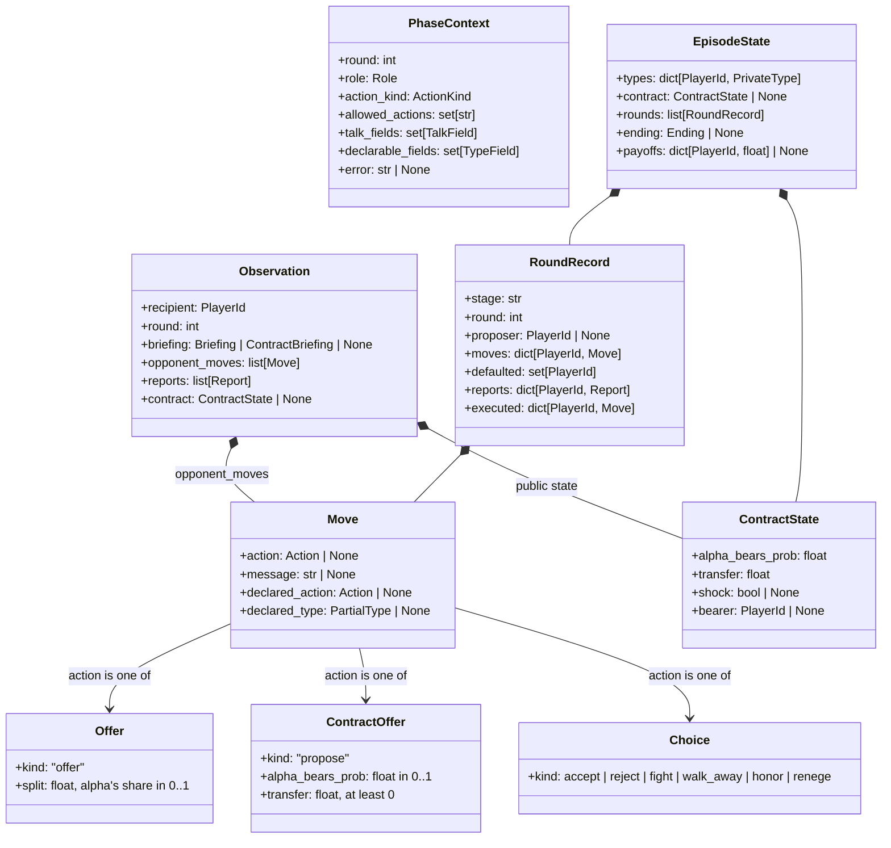

The briefings, one per game, are given only with a player's first observation:
- **`Briefing`** (crisis bargaining): `own_type`, `opponent_type` (a `PartialType`), `opponent_prior`, `private_fields`, `status_quo`, `termination`.
- **`ContractBriefing`**: `params` (all of `ContractParams`, which are public), `max_rounds`, `persuasion_rounds`.

The following mental models are worth keeping in mind:

- **`Observation` vs. `PhaseContext`.** An `Observation` is *what you've learned*. A `PhaseContext` is *what you're being asked to do*: your role, the exact `allowed_actions`, which talk fields are open, and why your last attempt was rejected. Players read their allowed actions from the context, never from a game table.
- **A message phase has no actions.** In a phase with `action_kind="message"`, `allowed_actions` is empty, `Move.action` must be `None`, and `Move.message` is the move itself.
- **`ContractState` is public.** It holds the signed terms and, after nature's draw, the shock and the bearer. It's attached to every observation, but it never contains the bearer's decision. That decision is a move the other player is never shown.
- **`PrivateType` vs. `PartialType`.** A `PrivateType` is a complete, true type. A `PartialType` is the same shape with holes (`None` means unknown or not stated). It's used for the opponent's public fields in a `Briefing` and for a `declared_type` claim. Contract dynamics has no types: `priors` is `None` and `types` is empty.
- **`Action` is a discriminated union** on `kind`. Pydantic chooses `Offer` (`"offer"`), `ContractOffer` (`"propose"`), `Rung` (`"rung"`) or `Choice` (every other kind) from it.
- **Stored values are always from alpha's side.** A split is alpha's share, and a contract's $q$ is the probability that alpha bears the cost. Only the presenters convert these to "your share" and "probability you bear".
- **Chosen vs. executed.** With the noise treatment on, a game's `NOISE` rule may change a move as it's carried out. `RoundRecord.moves` keeps the chosen move and `RoundRecord.executed` the changed one. The opponent, the ending rule and the end-of-round rule see the executed move; measures of intent keep using the chosen one. A move that noise leaves unchanged is not an accident, and default moves are never touched.
- **Reports are private.** A game with an end-of-round rule (`AFTER_ROUND`) tells each player what happened from its own side. A report reaches only its player, with that player's next observation, and stays in `RoundRecord.reports`. It's a flat dict: the game defines the keys and its presenter renders them.
- **`EpisodeState` is the full record** of an episode. Measures and scorers read only this object (plus the config and probe answers).

**Type aliases:**
- `PlayerId`: `alpha` / `beta`.
- `Role`: `proposer` / `responder` / `bearer` / `other` / `both`.
- `ActionKind`: `offer` / `response` / `message` / `decision` / `rung`.
- `TypeField`: `capability` / `cost_of_conflict`.
- `TalkField`: `message` / `declared_action` / `declared_type` / `declared_value`.
- `Report`: a flat dict of strings, numbers and booleans, with keys the game defines.
- `Ending`, for crisis bargaining: `agreement`, `fight`, `random_stop`.
- `Ending`, for contract dynamics: `walked_away`, `no_shock`, `honored`, `reneged`.
- `Ending`, for the nuclear crisis: `knockout`, `strategic_war`, `ceasefire`.
- `Ending`, for all: `horizon`.

## 4. The referee (`referee.py`)

### 4.1 The episode loop

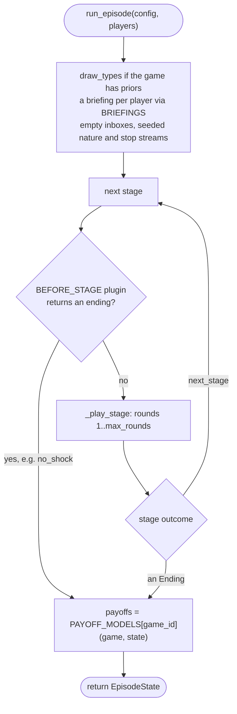

Inside `_play_stage`, each round runs the stage's phases. After every move, `ENDING_RULES` may return an `Ending` (the episode is over) or `"next_stage"` (for example, `accept` in contract dynamics). Once every phase of a round is played, a game's `AFTER_ROUND` rule, if it has one, returns a `RoundEnd`: a private report for each player and, optionally, an outcome that ends the episode or the stage. That's how a game ends on its own state rather than on a single move. If nothing ends the round, the referee draws the random stop between rounds, and a stage that runs out of rounds returns its `when_exhausted` value.

There are four separate seeded streams, so changing one kind of draw never shifts the others:
- types: `draw_types` with `seed`;
- nature: `random.Random(f"nature-{seed}")`, which draws the shock first and then the bearer;
- random stops: `random.Random(f"random_stop-{seed}")`;
- noise: `random.Random(f"noise-{seed}-{stage}-{round}-{player}")`, one per move, so one player's accidents never depend on the other's moves, and both episodes of a pair get the same accidents.

### 4.2 Who acts in a phase

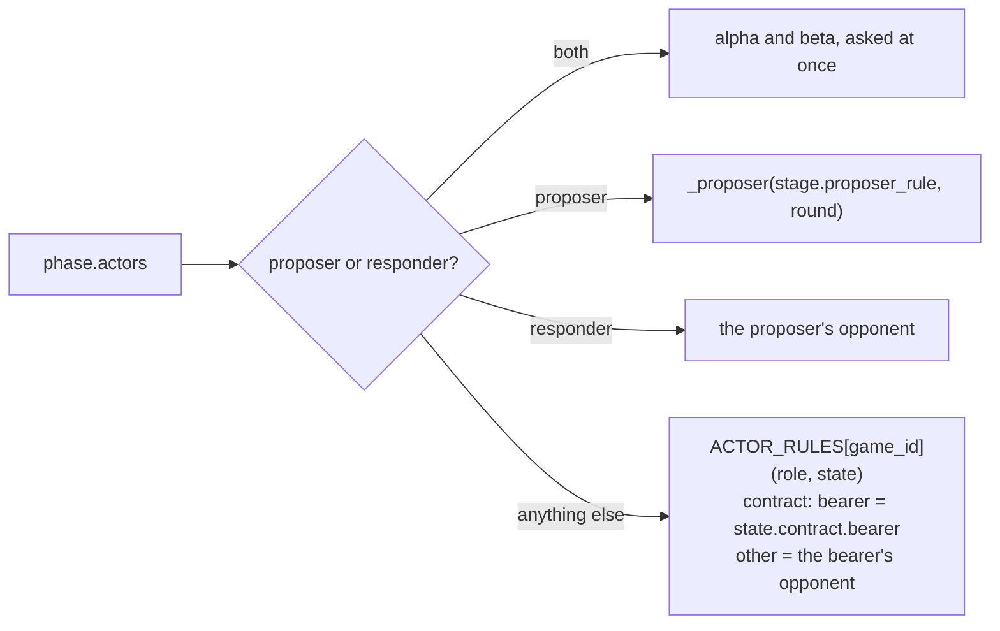

### 4.3 One phase, seen from a player

Before a player acts, the referee empties that player's **inbox**: every opponent move since the player last acted. It also empties the player's **reports**: what the game's end-of-round rule told it since then. The first observation also carries the **briefing**, and every observation carries the current public `ContractState`, if there is one.

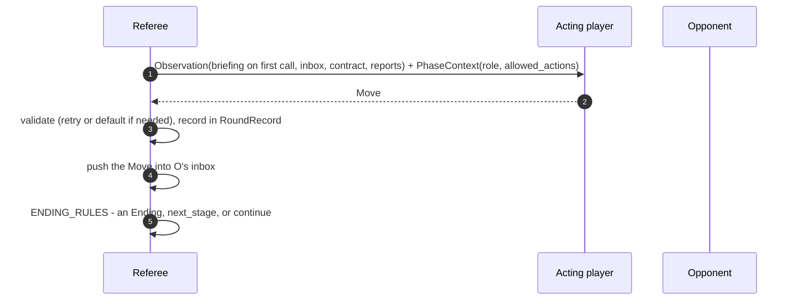

In a phase with `actors="both"`, the referee asks both players at once. Each observation is built before any move of the phase is in, so neither player sees the other's move until the next phase or round; both moves then enter the inboxes together, and `ENDING_RULES` runs once both are in, alpha's move first. Retries and default moves work per player, so a player that fails doesn't hold up the other.

In contract dynamics, the bearer's decision is the last move of the episode. It goes into the other player's inbox, but that inbox is never delivered, so the other player never sees the decision.

### 4.4 Getting a valid move: retries and default moves

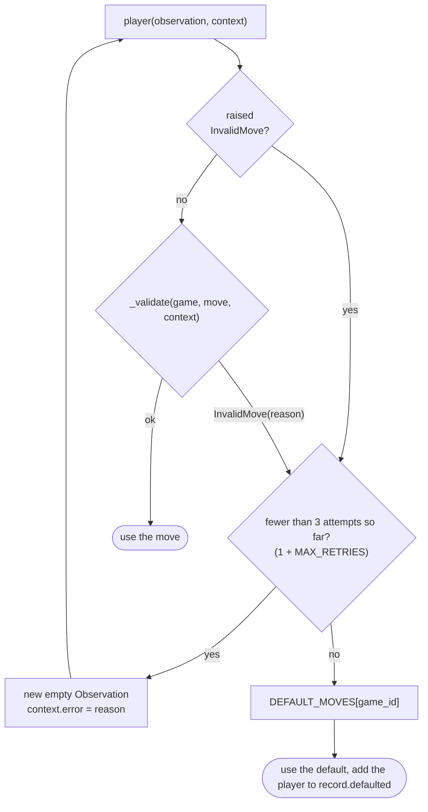

`_validate` checks four things, in order:
1. **Action.** The action is present and its kind is in `context.allowed_actions`. In a message phase, there must be no action.
2. **Talk.** Every talk field used is in `context.talk_fields`. In a message phase, `message` is always open.
3. **Declared type.** It only states fields in `context.declarable_fields`, which are the private ones.
4. **Game rules.** `MOVE_CHECKS[game_id]` returns no problem. For contract dynamics, that's the transfer cap.

Players can fail in two ways, and both go through the same retry path. Either the referee rejects the move, or the player raises `InvalidMove` itself, which is what `model_player` does when a tool call is missing or malformed.

Default moves per game:

| Phase | Crisis bargaining | Contract dynamics |
|---|---|---|
| Proposer | Repeat its last offer, or offer the status quo | Repeat its last proposal, or propose $(\tfrac12, 0)$ |
| Responder | `reject` | `reject` |
| Message | (none) | An empty message |
| Decision | (none) | `renege`. The honoring measures exclude defaulted decisions |

### 4.5 Plugin dicts and other constants

| Name | Maps `game_id` to | Crisis bargaining | Contract dynamics | Nuclear crisis |
|---|---|---|---|---|
| `ALLOWED_ACTIONS` | `ActionKind -> set of kinds` | offer: `{offer, fight}`; response: `{accept, reject, fight}` | offer: `{propose, walk_away}`; response: `{accept, reject, walk_away}`; message: `{}`; decision: `{honor, renege}` | rung: `{rung}` |
| `BRIEFINGS` | `(config, state, player) -> briefing` | `briefing` | `briefing` | `briefing`: the player's own worth |
| `ENDING_RULES` | `(Move) -> Ending \| "next_stage" \| None` | accept means agreement, fight means fight | accept means `next_stage`; `walk_away`, `honor` and `renege` end the episode | none: the state ends it, in `after_round` |
| `PAYOFF_MODELS` | `(GameSpec, EpisodeState) -> payoffs` | `episode_payoffs` | `episode_payoffs` | `episode_payoffs` |
| `DEFAULT_MOVES` | `(GameSpec, EpisodeState, PlayerId, PhaseContext) -> Move` | `default_move` | `default_move` | `default_move`: hold the last rung |
| `BEFORE_STAGE` (optional) | `(GameSpec, EpisodeState, StageSpec, Random) -> Ending \| None` | (absent) | `before_stage`: before `persuasion`, records the contract and draws shock and bearer | `before_stage`: sets up the territory, or a mid-crisis start |
| `MOVE_CHECKS` (optional) | `(GameSpec, Move) -> problem \| None` | (absent) | `move_problem`: the transfer cap | `move_problem`: announcements are rungs |
| `ACTOR_RULES` (optional) | `(Role, EpisodeState) -> PlayerId` | (absent) | `actor_for`: bearer and other | (absent) |
| `AFTER_ROUND` (optional) | `(GameSpec, EpisodeState, RoundRecord) -> RoundEnd` | (absent) | (absent) | `after_round`: territory, costs, burning oil, reports, endings |
| `NOISE` (optional) | `(GameSpec, EpisodeState, PlayerId, Move, Random) -> Move`, the move as carried out when the noise treatment hits | (absent) | (absent) | `misfire`: one to three rungs harsher |

The optional dicts are read with `.get`, so a game without nature or extra roles simply has no entry. Other constants: `MAX_RETRIES = 2` and `TALK_FIELDS`.

## 5. The game rules

Each game module has the same layers: pure formulas, then engine plugins built on them.

### 5.1 Crisis bargaining (`crisis_bargaining.py`)

```mermaid
flowchart LR
    subgraph Math["Formulas"]
        wp["win_probability(k_a, k_b)"]
        rv["reservation_value(player, p, c)"]
        br["bargaining_range(p, c_a, c_b)"]
        op["outcome_payoffs(ending, types, q, split)"]
    end
    subgraph Plugins["Engine plugins"]
        gs["crisis_bargaining_game(...) -> GameSpec"]
        bf["briefing(config, state, player)"]
        ea["ending_after_move(move)"]
        ep["episode_payoffs(game, state)"]
        dm["default_move(...)"]
    end
    subgraph Beliefs["Belief helpers: what a player can infer from its Briefing"]
        po["possible_opponent_types(briefing)<br/>grid of 200 points per private field"]
        ra["reservation_against(player, own, opp)"]
        er["expected_reservation_value(player, briefing)"]
    end
    rv --> wp
    br --> rv
    op --> rv
    ep --> op
    er --> po
    er --> ra --> rv
```

The belief helpers are shared by the Equilibrium Bot (its decisions) and the comprehension probe (its ground truth). That way "what the player should know" is defined in exactly one place.

### 5.2 Contract dynamics (`contract_dynamics.py`)

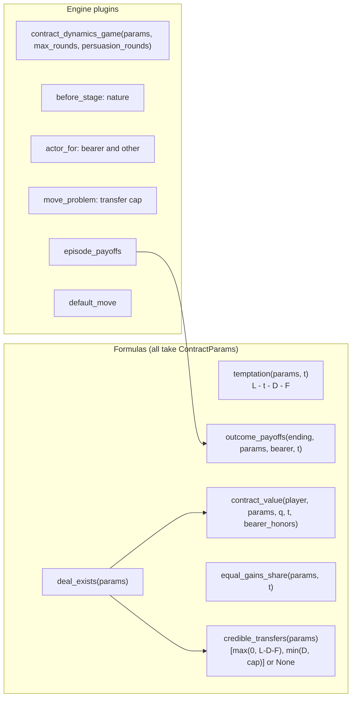

These formulas are used in three places:
- by the **rational bot**, to decide;
- by the **measures**: `temptation` for the failure types, `equal_gains_share` for the deviation, and `deal_exists` for missed deals;
- by the **tests**, which check them against the spec's worked example.

## 6. Players

### 6.1 Bots (`bots.py`)

Each bot is a **closure**: a factory function returns an `async play(observation, context)`, which keeps the bot's private memory between calls.

| Factory | Game | Memory | Behavior |
|---|---|---|---|
| `random_bot(seed)` | crisis | a seeded `random.Random` | Picks uniformly from `context.allowed_actions`; offers are uniform splits |
| `equilibrium_bot()` | crisis | its `Briefing` | Proposer: `_risk_return_share` against the opponent grid, breaking ties toward the most generous. Responder: accepts at or above `expected_reservation_value`, otherwise fights. Truthful declared types |
| `rational_contract_bot()` | contract | its `ContractBriefing` | Proposer: walks away if `deal_exists` is false; otherwise `_best_credible_contract`, which scans 101 credible transfers and picks the $(q^*(t), t)$ that maximizes the smaller side's value. Responder: accepts iff `contract_value` > 0, assuming the bearer honors iff $\tau \le 0$; otherwise walks away. Bearer: honors iff $\tau \le 0$. Sends empty messages |
| `scripted_contract_bot(decision, appeal)` | contract | none | Proposes $(\tfrac12, 0)$, accepts anything, sends `appeal` as the other player, and always makes `decision` as bearer. The task exposes it as `always_honor` and `always_renege` |

### 6.2 The model player (`model_player.py`) and presenters

`model_player(model, probe_log, presenter)` is also a closure. Its memory is:
- the model's **persistent conversation**;
- the IDs of tool calls still waiting for a result;
- the last `ContractState` it rendered, so contract news is shown only once.

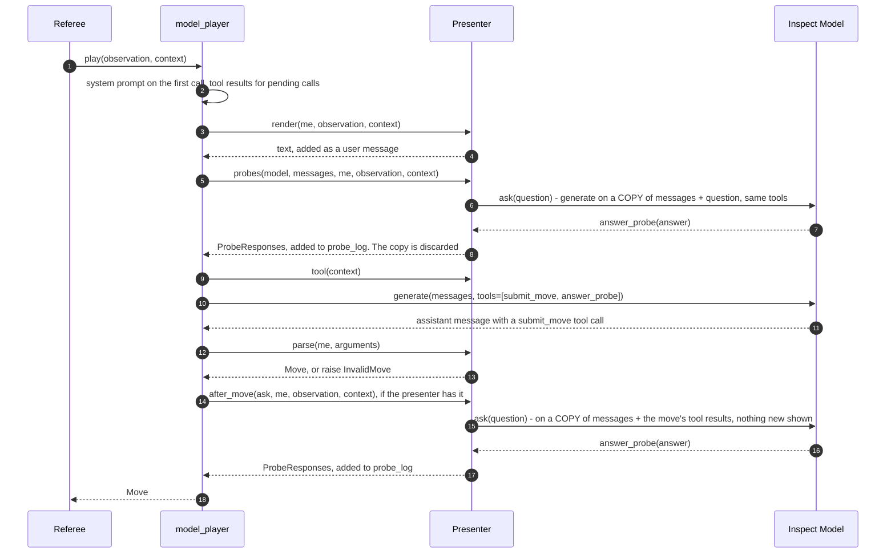

A `Presenter` is a frozen dataclass of five plain values, plus two optional ones:

| Field | Crisis bargaining | Contract dynamics | Nuclear crisis |
|---|---|---|---|
| `system_prompt` | Rules of alternating offers and fighting | Rules of the two stages; says the interaction is one-shot and anonymous | Short and framing-free; the rules come with the briefing |
| `render` | Types, priors, status quo, horizon; the opponent's offers as "offer you X of the stake" | Explicit payoff table, benefits, $p$, transfer regime, an enforcement statement ("a promise, not a lock" when $F = 0$); proposals as "you bear with probability X"; contract news; the current task | Military or neutral opening and rules, the ladder by name and description, and the player's worth; then each round from its own side, its own accident included, in the framing's words |
| `tool` | One schema for the whole episode: every action (`accept`, `fight`, `offer`, `reject`), `own_share`, plus the talk and `declared_*` fields the treatments open | One schema for the whole episode: every action, `probability_you_bear`, `transfer`, `message` (always, for persuasion), plus `promise` when open. `action` is optional because message phases have none | The option taken, plus `announced`, `claimed_worth` and `message` when open |
| `parse` | `own_share` to alpha's `split` | `probability_you_bear` to `alpha_bears_prob`; `promise` to `declared_action` | option names to `Rung`s; `claimed_worth` to `declared_value` |
| `probes(ask, me, observation, context)` | Comprehension (own expected fight payoff), once after the briefing, with its ground truth | Belief ($\pi$) before each response to an offer; comprehension (own payoff from reneging) before the decision. The ground truth is computed later, in the scorer | The territory's worth and trust in the opponent (0-100) before every move; after an opponent's climb, strike or accident with a confidence |
| `after_move` (optional, default none) | (none) | (none) | On rounds 1, 4, 7, ...: the worth right after the claim, and the same sum asked fresh |
| `answer_tool` (default `ANSWER_PROBE_TOOL`) | the default | the default | `ANSWER_WITH_CHOICE_TOOL` |

**Three ways to ask.** The `ask` a probe receives is callable: `await ask(question)` asks on a copy of the conversation and returns a number. `ask.choice(question, options)` also returns the option the model picked; it needs `ANSWER_WITH_CHOICE_TOOL` as the presenter's answer tool. `ask.fresh(question)` asks in a new conversation, with no role and no game history and only the answer tool. Probes in `after_move` ask on a copy where the move's tool calls are already answered, as if the move were accepted, before the player is shown anything new. The model player stamps every answer with the round of its move.

Two rules about tools, each checked by a test:

- **One tools list per conversation.** The list is `[submit_move, answer_probe]` (the presenter's `answer_tool`), computed on the first call and then reused for every move and every probe. Models with extended thinking return signed reasoning that is bound to the tools list it was created with, so changing the list mid-conversation makes the API reject the request (ADR 0001, amended). The current options are therefore stated in the rendered text (for example, "Your options: offer, fight."), not in the schema, and the referee rejects anything that isn't open.
- **Every tool call gets a matching tool result** before the next generate, labeled with the right function. A stray `answer_probe` call made alongside a move is answered with "Ignored" and doesn't invalidate the move.

## 7. The Inspect shell (`task.py`, `contract_task.py`)

### 7.1 From parameters to metrics

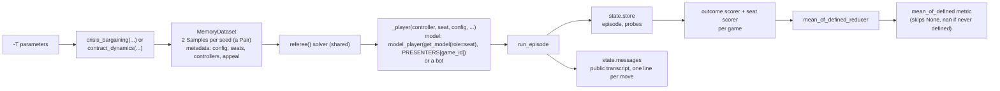

| | Crisis bargaining | Contract dynamics |
|---|---|---|
| Task | `crisis_bargaining` in `task.py` | `contract_dynamics` in `contract_task.py` |
| Controllers | `model`, `equilibrium`, `random` | `model`, `rational`, `always_honor`, `always_renege` |
| Outcome scorer | `outcome_scorer` from `outcome_measures` | `contract_outcome_scorer` from `contract_outcome_measures` |
| Seat scorer | `seat_scorer`: `player_measures` plus comprehension | `contract_seat_scorer`: `contract_player_measures`, plus comprehension, belief and belief error from the probes |

### 7.2 Seats vs. positions

Positions (`alpha` and `beta`) belong to the game. Seats (`a` and `b`) belong to the experiment, and each one maps to a controller and a model role. Each Pair swaps the mapping between them:

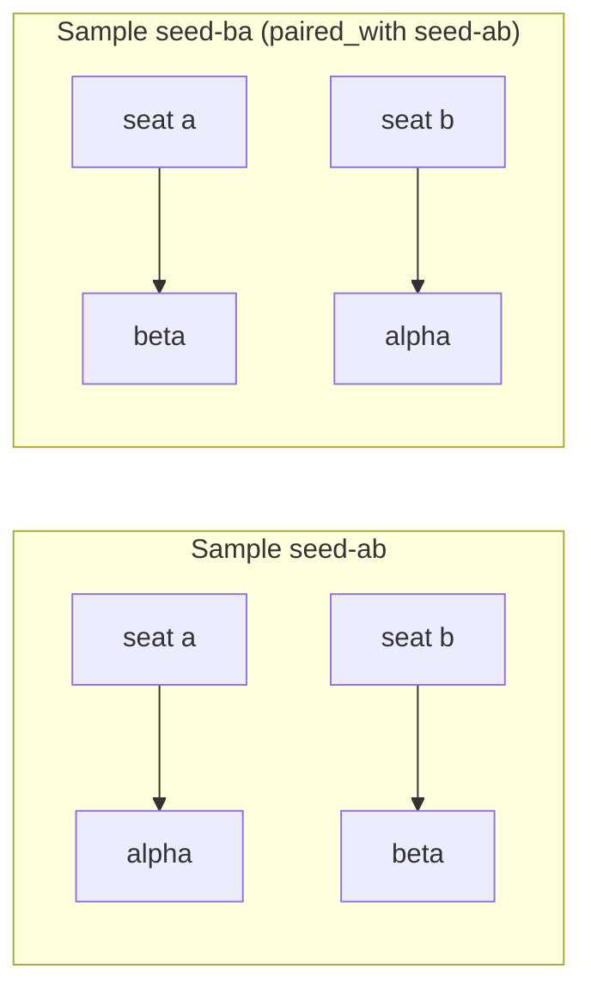

The seat scorers convert per-position measures back to seats (`a_...`, `b_...`), so each metric stays tied to the same model across the pair. In contract dynamics, benefits belong to positions. So when $b_\alpha \ne b_\beta$, each seat plays once with each benefit, which is what the fairness split (`honored_with_smaller_reward` vs. `_larger_reward`) relies on.

### 7.3 Why there's a custom reducer

Inspect always applies an epoch reducer, and the default one turns `None` into `0`. `None` means "not defined for this episode", for example `in_range` when there was no agreement, or `honored` when no shock hit. If those values became zeros, the averages would be wrong. `mean_of_defined_reducer` and the `mean_of_defined` metric skip `None` instead.

## 8. Where measures come from (`measures.py`)

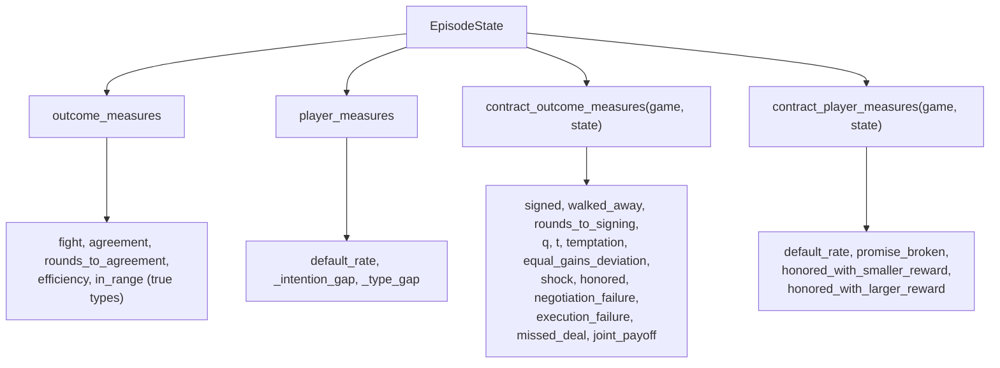

The probe-based measures are computed in the task modules:
- **Comprehension:** `task._comprehension` and `contract_task._comprehension`. The tolerance is 0.01, and the contract ground truth is $b_i - D - F$.
- **Belief:** `contract_task._mean_answer`.
- **Belief error:** `contract_task._partner_honored`.

## 9. Adding things

**A new bot.** Write a factory in `bots.py` that returns `async play(observation, context) -> Move`. Read allowed actions from `context.allowed_actions`. Then add it to `Controller` and `_player` in `task.py`.

**A new treatment.** Follow these steps:
1. Add a parameter model to `schema.py` and an optional field on `Treatments` (`None` means off). A game-specific number can go into that game's params instead, the way contract dynamics does.
2. Apply it in the referee or the game's plugins. Information treatments go in the game's `briefing`, and permissions go in `PhaseContext`, `_validate` or `MOVE_CHECKS`.
3. Render it in the game's presenter.
4. Expose it as a task parameter.

**A new game** (ADRs 0002 and 0003). Follow these steps:
1. Add its id to `GameId`, and its new roles, action kinds, actions and endings to the aliases in `schema.py`.
2. Write a rules module: a `GameSpec` factory (its stages), `ALLOWED_ACTIONS`, `briefing`, an ending rule, a payoff model and a default move. Add `before_stage`, `actor_for` and `move_problem` if the game needs nature, extra roles or extra rules.
3. Register these in the referee's plugin dicts.
4. Write a presenter and add it to `PRESENTERS` in `task.py`.
5. Write a task module with its scorers.

**Simultaneous moves.** Give a phase `actors="both"` (section 4.3). The divisible contract arm can use it.

## 10. Tests

Each game has six agreed seams. Only the last touches Inspect, and it uses the `mockllm` model, so the suite never calls a real API.

Engine features that no real game uses yet, such as simultaneous moves, end-of-round reports and execution noise, are tested in `test_engine.py` with a toy game that is registered in the plugin dicts only for those tests.

The nuclear crisis is tested in `test_nuclear_crisis.py`: its rules, episodes played through the referee, and its presenter with a mock model.

| Seam | Crisis bargaining | Contract dynamics | Checks |
|---|---|---|---|
| 1. Game rules | `test_crisis_bargaining_rules.py`, `test_outcome_payoffs.py` | `test_contract_rules.py` | Hand-computed values. For contracts: the spec's worked example, equal gains, the credible range, deal existence and its edge cases |
| 2. Type drawing / engine | `test_draw_types.py` | (the crisis tests, unchanged) | Seeds and order. The stage refactor was checked by the crisis suite staying green |
| 3. Referee | `test_referee.py` | `test_contract_referee.py` | Endings, observations, briefings, treatments, retries, defaults, talk. For contracts: nature, persuasion relay, the hidden decision, the imposed venture, the transfer cap, promises |
| 4. Bots | `test_equilibrium_bot.py`, `test_random_bot.py` | `test_contract_bots.py` | Theory benchmarks: complete-information agreement; no signing without transfers; signing at $t = L - D$ and honoring with free transfers; the unbalanced $q^*$ |
| 5. Measures | `test_measures.py` | `test_contract_measures.py` | Hand-built `EpisodeState`s: the three failure types, honoring that excludes defaults, promises, the fairness split |
| 6. Inspect end to end | `test_task.py` | `test_contract_task.py` | A mock model plays Pairs; probes never leak into the conversation; well-formed retries; undefined measures stay out of averages |
