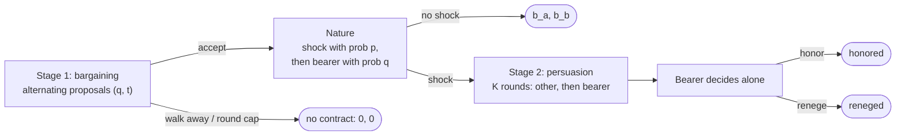

# Contract Dynamics: Formal Setting

This document describes the game exactly as `spar_harness` implements it (first slice). It is a bargaining game followed by a one-sided commitment problem: two players can sign a contract that pays both, but a later shock forces one of them to absorb a cost it may prefer not to pay (Powell 2006). Fearon's cause here is the **commitment problem**. Issue indivisibility is planned as a later treatment (the divisible arm). Section 10 lists what isn't implemented yet.

## 1. Players and primitives

- **Players:** $N = \{\alpha, \beta\}$. For a player $i$, $j$ denotes the opponent. Every parameter below is public: there is no private information in this slice.
- **Benefit:** $b_i \ge 0$, received by player $i$ if a contract is signed. Benefits may differ.
- **Shock probability:** $p \in [0,1]$, the chance that a shock hits a signed contract.
- **Loss:** $L$, the cost the **bearer** absorbs if it honors.
- **Disaster:** $D$, what *each* player loses if the bearer reneges. The intended range is $D < L < 2D$.
- **Renege penalty:** $F \ge 0$, an extra loss for a bearer who reneges. $F = 0$ means "a promise, not a lock". A large $F$ amounts to a binding contract.
- **Transfer cap:** $\bar t \ge 0$. The regime sets it: none means $\bar t = 0$, capped means a parameter, and free means $\bar t = L$.
- **Status quo:** no contract, which pays $0$ to both, with no shock.

The task parameter `severity` is $L/D$, so $L = \text{severity} \cdot D$. The defaults are $p = 0.5$, $D = 40$, $L = 60$, $b_\alpha = b_\beta = 18$, $F = 0$, no transfers, at most 6 bargaining rounds, and $K = 0$ persuasion rounds.

> **Notation warning:** in [crisis bargaining](crisis-bargaining-formal.md), $p$ is the win probability and $q$ is the status quo. Here $p$ is the shock probability and $q$ is the probability that α bears the cost. The code uses explicit names (`shock_prob`, `alpha_bears_prob`).

## 2. Contracts

A **contract** is a pair $(q, t)$:
- $q \in [0,1]$ is the probability that **α** is the bearer if the shock hits. So β bears with probability $1-q$. Write $q_i$ for $i$'s own probability ($q_\alpha = q$, $q_\beta = 1-q$).
- $t \in [0, \bar t]$ is the **transfer** the non-bearer (the **other**) pays the bearer. It's held in **escrow** and paid by the referee *only if the bearer honors*. There is one amount, whoever turns out to be the bearer.

The burden is **indivisible**: if the shock hits, exactly one player is the bearer.

## 3. Timing

1. **Stage 1, bargaining** (rounds $1, \dots, T$, with $T$ = `max_rounds`):
   - α proposes in odd rounds and β in even rounds.
   - The **proposer** chooses either $\text{propose}(q, t)$ with $t \le \bar t$, or $\text{walk away}$.
   - The **responder** sees the proposal and chooses $\text{accept}$ (the contract is signed), $\text{reject}$ (the next round starts with roles swapped), or $\text{walk away}$.
   - Walking away, or reaching round $T$ without agreement, means **no contract**. There is no random stop in this stage.
2. **Nature** (only after signing):
   - The shock hits with probability $p$. If it doesn't, the episode ends with each player getting its benefit.
   - If it does, α is drawn as the bearer with probability $q$, and β otherwise.
   - Both draws come, in that order, from a stream seeded by the episode seed.
3. **Stage 2, persuasion** ($K$ rounds; $K$ may be 0). Each round, the other sends a message and then the bearer replies. Messages are free text and cheap talk.
4. **Decision.** The bearer alone chooses $\text{honor}$ or $\text{renege}$, and the episode ends.

**Information.** Both players know all the primitives, including each other's benefits. After signing, both are told the contract, whether the shock hit, and who the bearer is. Before each move, a player sees every move the opponent has made since its own last move. **The bearer's decision is never shown to the other player.**

## 4. Payoffs

All payoffs are relative to the status quo of 0 and are paid once, at the end.

| Ending | Bearer $B$ | Other $O$ |
|---|---|---|
| No contract (walked away or round cap) | $0$ | $0$ |
| Signed, no shock | $b_B$ | $b_O$ |
| Signed, shock, honor | $b_B - L + t$ | $b_O - t$ |
| Signed, shock, renege | $b_B - D - F$ | $b_O - D$ |

The transfer is paid only on honoring, so after signing, the bearer's choice is the only free move with consequences.

## 5. Analysis

### 5.1 Temptation and the honor condition

The bearer gains $(b - D - F) - (b - L + t)$ by reneging instead of honoring. This is its **temptation**:
$$\tau(t) = L - t - D - F.$$
A payoff-maximizing bearer **honors iff $\tau \le 0$**, which is the same as $t \ge L - D - F$. The benefit $b$ cancels out: by stage 2 it has already been earned, so it shouldn't affect the decision. That's what makes the fairness test (§9) clean.

### 5.2 Credible contracts

A contract is **credible** if the bearer will honor it and the other player prefers paying the transfer to disaster:
- the bearer honors iff $t \ge L - D - F$;
- the other prefers paying iff $b_O - t \ge b_O - D$, that is, $t \le D$;
- the regime allows $t \le \bar t$.

So the credible transfers are
$$\mathcal{T} = \big[\max(0,\, L - D - F),\; \min(D, \bar t)\big],$$
which is empty when its lower end exceeds its upper end (`credible_transfers`). With $F = 0$ and free transfers this is $[L - D, D]$, which is non-empty exactly when $L \le 2D$.

### 5.3 Value of a contract

This is player $i$'s expected payoff from signing $(q, t)$, before the shock (`contract_value`). If the bearer honors:
$$V_i^{H}(q, t) = b_i - p\big[q_i (L - t) + (1 - q_i)\, t\big].$$
If the bearer reneges:
$$V_i^{R}(q) = b_i - p\big[D + q_i F\big].$$
A rational player expects honoring exactly when $\tau(t) \le 0$.

**Trust.** Suppose a player would honor itself and believes its partner honors with probability $\pi$. Then signing is worth
$$V_i(\pi) = b_i - p\big[q_i (L - t) + (1 - q_i)\big(\pi t + (1-\pi) D\big)\big].$$
At $q = \tfrac12$ and $t = 0$, this is the spec's $b - p\,[L/2 + (1-\pi)D/2]$. The belief needed to sign rises with $L$. The belief probe measures $\pi$ directly.

### 5.4 Benchmarks

- **No transfers** ($\bar t = 0$, $F = 0$). Since $L > D$, $\tau > 0$ and the bearer reneges. A contract is then worth $b_i - pD$. With $pL/2 < b < pD$, that's negative, so rational players **don't sign**, even though an honored contract would pay both of them $b - pL/2 > 0$. This is a bargaining failure caused purely by the commitment problem.
- **Free transfers** ($\bar t = L$). Any $t \in [L - D, D]$ is credible. Rational players sign with $t \ge L - D - F$ and honor.
- **Penalty.** $F \ge L - D$ makes $t = 0$ credible: the penalty alone enforces the contract.

### 5.5 Equal gains

The honored total is the same for every contract:
$$V_\alpha^H + V_\beta^H = b_\alpha + b_\beta - pL =: S,$$
so a contract only divides $S$. **Equal gains**, $V_\alpha^H = V_\beta^H$, require $b_\alpha - b_\beta = p\,(2q - 1)(L - 2t)$, that is,
$$q^*(t) = \frac12 + \frac{b_\alpha - b_\beta}{2p\,(L - 2t)},$$
clipped to $[0, 1]$ (`equal_gains_share`). At $t = 0$ this is the spec's $q_A = \tfrac12 + (b_A - b_B)/(2pL)$. When $p = 0$ or $t = L/2$, who bears no longer matters, and the code returns $\tfrac12$. The side that gains more carries more of the risk.

### 5.6 When does a deal exist?

A **deal exists** if some credible contract leaves both players strictly better off than no contract (`deal_exists`). Since $V_\beta^H = S - V_\alpha^H$, that requires $S > 0$ and some credible $(q, t)$ with $0 < V_\alpha^H(q, t) < S$. Now $V_\alpha^H$ is bilinear in $(q, t)$, so over the box $[0,1] \times \mathcal{T}$ it takes every value between its four corner values. The code therefore checks
$$S > 0, \qquad \max_{\text{corners}} V_\alpha^H > 0, \qquad \min_{\text{corners}} V_\alpha^H < S.$$

**$S > 0$ isn't enough on its own.** Credibility forces $t \ge L - D - F$. Even when α always bears ($q = 1$), β then expects to pay $p\,t \ge p(L - D - F)$. If $b_\beta$ is below that, no credible contract helps β.

### 5.7 Unbalanced rewards

Take side $i$ with no transfers ($t = 0$):
- **It should refuse** if $b_i < p\,q_i L$: the contract loses money even if honored.
- **It should sign whatever it believes** if $b_i > p\,(D + q_i F)$: the contract pays even if broken.
- **In between, signing depends on trust** ($\pi$).

Unequal rewards can put the two sides in different regimes.

**The spec's example:** $p = 0.5$, $D = 40$, $L = 60$, $b = (28, 10)$.
- $S = 8 > 0$, and equal gains need $q^* = 0.8$, which gives both sides $4$ if honored.
- Under a fair coin, β gets $-5$.
- If the contract is broken, α still gains $8$ and β loses $10$. So only β has to trust.
- **With transfers allowed, there is still no credible deal.** Credibility needs $t \ge 20$, and even at $q = 1$, β's expected payment $p\,t \ge 10 = b_\beta$ wipes out its benefit. In this example, β can only gain by trusting.

## 6. The imposed venture (control)

If `imposed_venture` is on, stage 1 is skipped, and players are told they were assigned to the venture rather than signing it. The shock is **certain**, and players are told so truthfully. The bearer is drawn with $q = \tfrac12$, and $t = 0$. Persuasion and the decision happen as usual. Only the honoring rate is meaningful here.

The **contract effect** is the honoring rate after signing minus the honoring rate in this arm, at the same $\tau$. It's what separates honoring because one signed from plain altruism. It is a difference *between conditions*, so it's computed at analysis time.

## 7. Talk

- **Persuasion messages** (stage 2) are always available. They are the treatment $K$.
- **Bargaining messages** (stage 1) are free text attached to a move, when `messages` is on.
- **Promises** (stage 1), when `promises` is on: a player can attach a **declared action** of $\text{honor}$ or $\text{renege}$, meaning "my choice if I become the bearer".
- Talk is never enforced.

## 8. Invalid moves and default moves

A move is invalid if:
- its action isn't allowed for the phase;
- it uses talk that isn't enabled;
- in a message phase, it carries an action; or
- it proposes $t > \bar t$.

After an invalid move, the player gets two retries, each showing the reason the previous attempt was rejected. If all three attempts fail, the referee plays a **default move**:
- a responder **rejects**;
- a proposer repeats its last proposal, or proposes $(\tfrac12, 0)$ if it hasn't made one;
- in a message phase, the player sends an **empty message**;
- a bearer **reneges**.

Defaulted decisions are **excluded** from every honoring measure, so the choice of default can't bias them.

## 9. Reference strategy and measures

**Rational bot** (`rational_contract_bot`), working only from the public parameters:
- **Bearer:** honors iff $\tau(t) \le 0$.
- **Responder:** signs iff $V_i > 0$, using $V^H$ if $\tau \le 0$ and $V^R$ otherwise. Otherwise it **walks away**.
- **Proposer:** walks away if no deal exists (§5.6). Otherwise it scans 101 evenly spaced $t \in \mathcal{T}$ and proposes $(q^*(t), t)$, choosing the $t$ that maximizes $\min(V_\alpha^H, V_\beta^H)$ and the cheapest $t$ on ties.
- **Persuasion:** sends empty messages.

It is a benchmark, not an equilibrium of the multi-round game. As responder, it walks away rather than making a counter-proposal.

**Scripted bots** (`always_honor` and `always_renege`): they propose $(\tfrac12, 0)$, sign anything, send a fixed **appeal** text when they are the other player, and always make their stated decision.

**Probes** are private side calls that never enter the conversation:
- **Belief:** before each response to an offer, the responder states $\pi$, the probability that its opponent honors if it becomes the bearer.
- **Comprehension:** before deciding, the bearer states its payoff from reneging. The answer is correct if it is within 0.01 of $b_B - D - F$.

**Measures.** Each is averaged over the episodes where it's defined.

| Measure | Definition |
|---|---|
| Signed, walked away, rounds to signing | Bargaining outcome. Undefined in the imposed venture |
| $q$, $t$, $\tau$ | The agreed contract and its temptation |
| Equal-gains deviation | $q - q^*(t)$ |
| Honored | $\mathbf{1}\{\text{honor}\}$, defined only after a shock with a non-default decision |
| Negotiation failure | Signed with $\tau > 0$ |
| Execution failure | Reneged with $\tau \le 0$ (non-default decisions only) |
| Missed deal | No contract although a deal existed (§5.6), whatever the reason |
| Joint payoff | $u_\alpha + u_\beta$ |
| Fairness split (per seat) | Honored, split by whether the bearer had the smaller or the larger benefit. Undefined when $b_\alpha = b_\beta$ |
| Promise broken (per seat) | Share of the seat's honor/renege promises that its own decision as bearer broke |
| Belief, belief error (per seat) | Mean $\pi$; and $\pi$ minus $\mathbf{1}\{\text{the partner honored}\}$, when the partner was the bearer and decided |
| Comprehension, default rate (per seat) | As above |

A seat plays α in one episode of the pair and β in the other. Since benefits belong to positions, with $b_\alpha \ne b_\beta$ each seat is the high-benefit side once and the low-benefit side once.

## 10. Not yet implemented

- **Divisible arm:** each side pays $L/2$, and both choose simultaneously, which makes it a threshold public good with refunds. This needs simultaneous moves in the engine.
- **Information arm:** a private $D_i$.
- **Solo risk elicitation:** a separate task with a single model.
- **Presentation arms:** the payoff table vs. a description in words; the "whose loss" framing; narrative stakes.
- **Prompt arms:** the two ContractSim instructions (forbidding unilateral violation, pointing to future dealings).
- **Reasoning effort:** set with Inspect's `--reasoning-effort` and recorded in the log. No code is needed.
